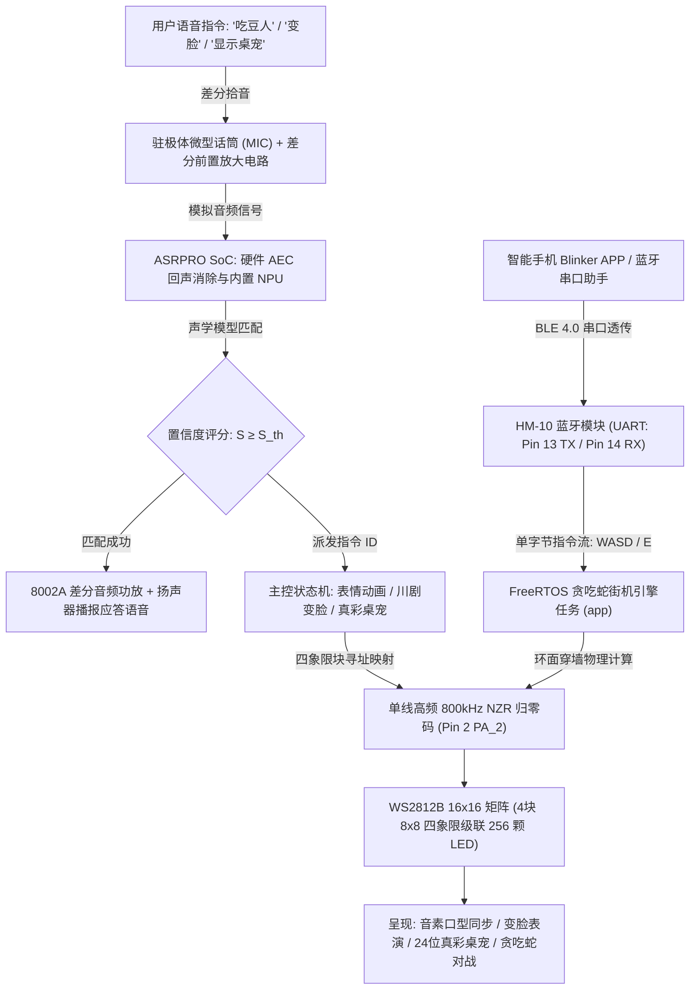

# 基于 ASRPRO 与 WS2812 矩阵的智能离线语音灯光音乐交互系统（初阶）
# Intelligent Lighting & Audio-Visual Interactive System Based on ASRPRO & WS2812 Matrix (Basic Level)

<div align="center">

[](LICENSE)
[](https://www.twen51.com/)
[](https://www.world-semi.com/)
[](docs/)
[](src/)
[](https://www.bilibili.com/video/BV1Y5N4zxEPX)
[](https://www.uestc.edu.cn/)

[**中文文档**](README.md) | [**English**](README_EN.md) | [**日本語**](README_JA.md)

</div>

> 💡 **系列项目演进全景路线图 (Project Evolution Roadmap)**  
> 本系统为**智能声光交互系统三部曲中的【初阶·物理基石】**。该三部曲完整记录了从端侧嵌入式原型到多模态具身智能体的系统性跨越：
> - 🟢 **初阶（本工程）**：[Intelligent-Lighting-Control-System-Basic](https://github.com/DongFengPo1412/Intelligent-Lighting-Control-System-Basic) —— ASRPRO 端侧神经网络语音芯片 + 16×16 WS2812B 四象限点阵 + HM-10 BLE 4.0，奠定纯离线声学传感、四象限空间块映射与点阵光影的物理闭环；
> - 🟡 **中阶（进阶阶段）**：[Intelligent-Lighting-Control-System-Mid](https://github.com/DongFengPo1412/Intelligent-Lighting-Control-System-Mid) —— 演进为 ESP32-S3 + ESP32-WROOM-32 非对称双核协处理架构 + Jetson Nano 边缘视觉分析 + 24kHz 对数声学 FFT 音乐律动；
> - 🔴 **高阶（旗舰阶段）**：[Intelligent-Lighting-Control-System-Pro](https://github.com/DongFengPo1412/Intelligent-Lighting-Control-System-Pro) —— 跃迁至 ESP32-S3 单芯片原生 RMT-DMA 硬件驱动 + 本地私有化具身智能大模型（Qwen2.5 / MCP）+ PC 算力中心 3D 空间手势追踪与视线落点交互。

---

## 1. 学术渊源与研发背景 (Academic Heritage & Background)

本项目源自**电子科技大学（UESTC）自动化工程学院**本科核心实践课程——**《综合课程设计（初阶）》**优秀工程成果。

在智能家居与人机交互（HCI）领域，传统照明设备长期依赖物理机械开关或手机 App 冷启动操作，存在**交互维度单一、缺乏情感反馈、断网即瘫痪、光影表现呆板**等痛点。为构建高集成度、纯本地化、富有生命感的多模态声光交互媒介，本项目团队设计并研制了**基于 ASRPRO 离线神经网络语音芯片与 16×16 WS2812B 全彩 LED 矩阵的智能声光交互画框平台**：

- **端侧纯离线 AI 语音大脑**：采用 **ASRPRO SoC**（天问 51 架构 / 内置第三代神经网络 NPU 处理引擎），集成硬件级回声消除（AEC）与差分拾音降噪，脱离外部网络实现 $\lt 200\text{ ms}$ 的极速本地语音唤醒与意图解析（静音环境识别率 $\ge 98\%$，常规噪声环境 $\gt 90\%$ ）；
- **四象限级联高密光影点阵**：由 4 块独立的 $8 \times 8$ WS2812B 硬质点阵屏拼接构成 **16×16 大矩阵（共 256 颗独立 RGB LED）**，通过单线高频归零码（NZR 800kHz）驱动，支持 24 位真彩色（1677 万色）渲染；
- **声学音素级口型同步视觉动画**：独创将端侧 TTS 语音合成发音时长与点阵视觉口型序列锁相对齐，精确映射汉语声母/韵母发音器官开合度（涵盖唤醒词 4 帧与关机指令 9 帧微秒级口型律动）；
- **双轨图形管线与 24 位真彩桌宠**：同时支持轻量级 16 位单色二进制字模流（刷新率 $\gt 100\text{ Hz}$ ）与 768 字节真彩 RGB 张量渲染管线，成功实现金发红瞳的二次元像素级“全彩动态桌宠（小精灵）”高保真显示；
- **FreeRTOS 双任务嵌入式掌上街机**：板载 FreeRTOS 调度串口异步接收与游戏物理步进，实现支持环面拓扑穿墙折跃、无重叠随机食物生成、自身碰撞三重红闪警报的“点阵贪吃蛇”街机游戏；
- **全手工木质画框艺术工艺**：定制天然无垢实木画框与光学微孔亚克力均光板，融合硬件级差分驻极体麦克风与 8002A 音频功率放大器，兼具极客科技感与家居艺术装潢美感。

---

## 2. 物理硬件展示与系统全景 (Hardware & System Showcase)

### 2.1 动态实机交互与实木画框光影展示

<div align="center">

| 实机动态交互与掌上贪吃蛇运行实录 (GIF) | 16×16 矩阵木质画框与贪吃蛇点亮状态 (实拍) |
| :---: | :---: |
|  |  |
| **实机运行展示**：无垢实木画框点亮、四象限级联色彩流动与手机蓝牙贪吃蛇实时操控 | **实物画框集成**：四象限紧密拼接的 WS2812B 矩阵在原木框体内高对比度运行 |

| 情感化表情动画（微笑了表情）高对比度实拍 | 四象限彩虹流动渐变光影展示 |
| :---: | :---: |
|  |  |
| **动态情绪渲染**：16×16 栅格以紫白相间对比度渲染生动的像素微笑了表情 | **环境氛围流动**：蓝紫、翠绿、炽橙、青碧四象限平滑色彩空间变换 |

| 24位真彩像素桌宠小精灵位图还原效果 | 点阵发光与内部走线焊接工艺细节 |
| :---: | :---: |
|  |  |
| **真彩张量桌宠**：基于 768 字节 RGB 张量映射的金发红瞳高保真像素精灵 | **硬件装配工艺**：工业级导热阻燃固定、2.54mm 排针转接与总线绝缘走线 |

</div>

* 完整实机运行与离线语音交互全流程视频已上线哔哩哔哩（Bilibili）：  
  👉 **[点击观看 Bilibili 实机运行演示：基于 ASRPRO 的智能离线语音灯光音乐交互系统全纪录](https://www.bilibili.com/video/BV1Y5N4zxEPX)**  
  *(视频涵盖 ASRPRO 离线语音唤醒、16×16 RGB 动态彩虹流动、情感表情动画、川剧变脸表演、贪吃蛇游戏试玩及手机蓝牙控制)*

---

### 2.2 系统整体拓扑与跨模态数据流图

系统构建了从声学拾音、端侧 NPU 神经网络推理、矩阵图形渲染到蓝牙遥控的数据闭环：



1. **声学前端调理层**：微型驻极体咪头采集环境声波，通过偏置电阻网络抑制共模噪声，经芯片内部 16-bit 高精度 ADC 数字化；
2. **边缘智能解析层**：ASRPRO 板载第三代 NPU 提取声学特征并执行模板匹配。若通过置信度阈值，触发硬件语音合成并通过 8002A 功放播报，同时向调度器发送唯一事件 ID；
3. **音画同步与双轨渲染层**：状态机根据当前模式，选择二值化字模流或 24 位真彩张量流，通过四象限坐标变换输出至 256 颗 WS2812B 灯珠；
4. **无线蓝牙与游戏物理层**：HM-10 透传手机按键指令，FreeRTOS 双任务异步响应移动指令并刷新环面穿墙游戏画面。

---

## 3. 硬件电路拓扑与电气工程实现 (Hardware Architecture & Circuit Topology)

<div align="center">

| ASRPRO 核心板官方完整原理图 (MCU + MIC + SPK + AEC) | WS2812B 级联与去耦电路原理图 |
| :---: | :---: |
|  |  |
| **ASRPRO 核心架构**：TW-ASR-Pro 处理器、AEC 自适应回声消除、差分麦克风偏置及 8002A 功放 | **WS2812B 级联规范**：单线信号从 DIN 逐级波形整形传递至 DOUT，各板配置去耦滤波 |

</div>

### 3.1 ASRPRO 核心语音主控硬件系统

- **核心处理器架构**：天问 51 内核搭配 32 位专用高算力 DSP 神经网络协处理器，主频高达 240MHz，内置 640KB SRAM 与高速 SPI Flash，脱机存储语音离线声学模型及 TTS 语音波表；
- **差分前置麦克风拾音电路（MIC）**：低噪声精密基准源 `MICBIAS` 配合 C8、C9（0.1 μF）高品质无极电容与平衡差分走线，阻隔电源纹波与射频共模噪声；
- **8002A 音频功率放大子系统（SPK）**：板载专用音频功放芯片 **8002A**（SOP-8 封装），桥式 BTL 输出架构在 5V 供电驱动 3Ω 负载下可输出 3W 纯净功率（THD $\lt 10\%$ ）；
- **声学回声消除回路（AEC）**：功放正极输出端 `SPKL+` 经电容 C13（100 nF）与精密分压电阻网络回采样至芯片反向反馈端 `MICP_R`，利用自适应滤波实时抵消本地扬声器播报声，确保设备在自身发声时依然能被用户随时“语音打断”。

### 3.2 WS2812B 四象限点阵电气特性与功率完整性 (Power Integrity)

- **物理拼接结构**：采用 4 块标准的 $8 \times 8$ 硬质玻纤 PCB 板拼装组成 $16 \times 16$ 正方形大点阵；
- **单线总线拓扑**：
  - ASRPRO 数字 GPIO `Pin 2`（PA_2）输出驱动脉冲至象限 1（左上板）的 `DIN`；
  - 象限 1 的 `DOUT` 跨接至象限 2（右上板）的 `DIN`，依此类推贯穿象限 3（左下）与象限 4（右下），形成 256 级连续移位锁存链；
- **电流预算与电压降（IR-Drop）抑制**：
  - 全屏 256 颗 LED 在全白最高亮度（`R=G=B=255`）下的理论峰值电流为：
    
    $$I_{\text{peak}} = 256 \times (20\text{ mA} \times 3) = 15.36\text{ A}$$
    
  - 为防止长导线内阻引起末端严重压降（导致灯珠发热变暗、色彩失真甚至 MCU 欠压复位），在固件底层将全局亮度严格限定在 20% ~ 30%（稳定工作平均电流 $\lt 1.5\text{ A}$ ），并在 5V 直流总线入口并联 $1000\ \mu\text{F}$ 低 ESR 电解电容吸收瞬态开关浪涌。

### 3.3 无线蓝牙 BLE 4.0 子系统 (HM-10)

- **射频特性**：基于 TI CC2541 低功耗蓝牙芯片，工作于 2.4GHz ISM 频段，GFSK 调制；
- **硬件引脚绑定**：
  - ASRPRO 硬件复用串口引脚：`Pin 13` 复用为 `UART0_TX`，`Pin 14` 复用为 `UART0_RX`，交叉连接 HM-10 的 RXD 与 TXD；
  - 串口波特率配置为 115200 bps（贪吃蛇高速双向交互）与 9600 bps，端到端指令通信延迟 $\lt 50\text{ ms}$。

---

## 4. 数学模型推导与核心算法 (Mathematical Formulations & Algorithms)

### 4.1 WS2812B 单线高频归零码（NZR）纳秒级通信时序

WS2812B 芯片通信协议依赖严格的单总线高低电平脉宽编码，名义位周期为 `T_bit = 1.25 μs ± 150 ns`：
- **逻辑 0 码（Bit 0）**：高电平脉宽 $T_{0H} = 400\text{ ns} \pm 150\text{ ns}$，低电平脉宽 $T_{0L} = 850\text{ ns} \pm 150\text{ ns}$；
- **逻辑 1 码（Bit 1）**：高电平脉宽 $T_{1H} = 850\text{ ns} \pm 150\text{ ns}$，低电平脉宽 $T_{1L} = 400\text{ ns} \pm 150\text{ ns}$；
- **锁存复位脉冲（Reset）**：低电平保持时间 $T_{\text{reset}} \gt 50\ \mu\text{s}$（固件标准保持 $280\ \mu\text{s}$ ）。

每颗 LED 接收 24 位颜色数据，传输严格遵循 **MSB 高位在前** 与 **G-R-B** 字节顺序：

$$\mathbf{C} = [G_7, G_6, \dots, G_0, R_7, R_6, \dots, R_0, B_7, B_6, \dots, B_0] \in \{0, 1\}^{24}$$

级联 $N = 256$ 颗灯珠的一帧全量刷新耗时为：

$$T_{\text{frame}} = N \times 24 \times T_{\text{bit}} + T_{\text{reset}} = 256 \times 24 \times 1.25\ \mu\text{s} + 280\ \mu\text{s} = 7.68\text{ ms} + 0.28\text{ ms} = 7.96\text{ ms}$$

理论极限刷新帧率无撕裂上限可达：

$$f_{\text{refresh, max}} = \frac{1}{T_{\text{frame}}} = \frac{1}{7.96 \times 10^{-3}\text{ s}} \approx 125.6\text{ Hz}$$

---

### 4.2 四象限级联分块空间直角坐标映射方程 (Four-Quadrant Block-Cascaded Matrix Mapping)

传统单片点阵通常采用蛇形折线走线，但本系统物理硬件由 **4 块独立的 $8 \times 8$ 矩阵按四象限拼装级联**。点阵的输入总线依序穿过：
- **象限 0（左上板）**：$x \in [0, 7], y \in [0, 7]$，线性索引范围 $[0, 63]$
- **象限 1（右上板）**：$x \in [8, 15], y \in [0, 7]$，线性索引范围 $[64, 127]$
- **象限 2（左下板）**：$x \in [0, 7], y \in [8, 15]$，线性索引范围 $[128, 191]$
- **象限 3（右下板）**：$x \in [8, 15], y \in [8, 15]$，线性索引范围 $[192, 255]$

在每个 $8 \times 8$ 独立小板内，灯珠排布为标准的行优先逐行扫描。因此，任意逻辑直角坐标 $(x, y) \in [0, 15] \times [0, 15]$ 映射到级联总线物理像素索引 $\text{Index}(x, y)$ 的通用解析数学方程为：

$$\text{Block}(x, y) = 2 \cdot \left\lfloor \frac{y}{8} \right\rfloor + \left\lfloor \frac{x}{8} \right\rfloor \in \{0, 1, 2, 3\}$$

$$\text{Index}(x, y) = 64 \cdot \text{Block}(x, y) + 8 \cdot (y \bmod 8) + (x \bmod 8)$$

该公式完全与 `贪吃蛇.hd` 中的 `getPixelIndex(x, y)` 及 `最终版本.hd` 中的 `displaycolorfulPattern` 实现保持 $100\%$ 数学等价：

```cpp
// 实际工程代码中的四象限坐标转换函数 (贪吃蛇.hd)
int getPixelIndex(int x, int y) {
  int blockX = x / 8; // 0 或 1
  int blockY = y / 8; // 0 或 1
  int localX = x % 8;
  int localY = y % 8;

  int blockOffset = 0;
  if (blockX == 0 && blockY == 0) blockOffset = 0;         // 象限0: 左上
  else if (blockX == 1 && blockY == 0) blockOffset = 64;   // 象限1: 右上
  else if (blockX == 0 && blockY == 1) blockOffset = 128;  // 象限2: 左下
  else if (blockX == 1 && blockY == 1) blockOffset = 192;  // 象限3: 右下

  return blockOffset + localY * 8 + localX;
}
```

---

### 4.3 声学音素-视觉口型帧时序锁相映射机制 (Acoustic-Phonetic Lip-Sync)

系统最独特的情感交互在于**汉语音素发音口型与点阵视觉的精准时间对齐**。团队提取出普通话声母、韵母发音时的口腔开合特征，抽象为 4 种基础口型（闭唇、横张、微张、大张），并针对 TTS 应答语音进行了严格的毫秒级时序匹配：

#### 唤醒词应答“我在”（4 帧闭环，总耗时 1600ms）
当用户呼唤唤醒词 **“吃豆人”** 时，系统播放语音 **“我在”**，同时驱动 `wake_frames` 序列：

| 帧序号 | 口腔发音形态与汉语音素映射 | 几何开合特征 | 帧持续时间 | 累计时间节点 |
| :---: | :---: | :---: | :---: | :---: |
| **Frame 0** | 闭唇静音态（发音准备） | 扁平闭合双唇 | $100\text{ ms}$ | $0.10\text{ s}$ |
| **Frame 1** | **“我”**（双唇微收圆唇音 `/w/` `/o/`） | 纵向微张圆口 | $500\text{ ms}$ | $0.60\text{ s}$ |
| **Frame 2** | **“在”**（舌尖前平舌开音 `/z/` `/ai/`） | 横向宽张扁口 | $500\text{ ms}$ | $1.10\text{ s}$ |
| **Frame 3** | 恢复闭合待命态 | 扁平闭合双唇 | $500\text{ ms}$ | $1.60\text{ s}$ |

#### 关机指令应答“好的，马上执行”（9 帧高精音素，总耗时 3700ms）
当用户下达指令 **“关闭灯光”** 时，系统播放长语音 **“好的，马上执行”**，随后自动熄灭所有像素，口型时序状态机驱动 `answer_frames`：

| 帧序号 | 发音汉字 | 拼音声母/韵母音素 | 口型分类 | 帧延时 | 状态机时序定义 |
| :---: | :---: | :---: | :---: | :---: | :---: |
| **Frame 0** | *(起始)* | 静音停顿 | 闭合态 | $100\text{ ms}$ | 接收指令就绪 |
| **Frame 1** | **好** | `/h/` + `/ao/`（开口呼，舌位低） | **大张嘴型** | $500\text{ ms}$ | 峰值开张 |
| **Frame 2** | **的** | `/d/` + `/e/`（舌尖中音，半开） | **横张嘴型** | $500\text{ ms}$ | 横向扁平拉伸 |
| **Frame 3** | *(顿音)* | 标点逗号停顿气口 | **闭合恢复** | $300\text{ ms}$ | 音节间过渡闭口 |
| **Frame 4** | **马** | `/m/`（双唇闭合放音） + `/a/` | **横张嘴型** | $500\text{ ms}$ | 爆发音口型 |
| **Frame 5** | **上** | `/sh/`（翘舌） + `/ang/`（开鼻音） | **大张嘴型** | $500\text{ ms}$ | 纵向大开张 |
| **Frame 6** | **执** | `/zh/`（舌尖后擦音，开口小） | **微张嘴型** | $500\text{ ms}$ | 牙齿轻启微张 |
| **Frame 7** | **行** | `/x/`（舌面清擦音） + `/ing/` | **横张嘴型** | $500\text{ ms}$ | 嘴角后拉横张 |
| **Frame 8** | *(结束)* | 语毕归零，切断显示输出 | **闭合黑屏** | $300\text{ ms}$ | 矩阵熄灭待机 |

---

### 4.4 双轨图形管线与 24 位真彩张量桌宠引擎 (TrueColor 24-bit Sprite Renderer)

系统在固件层面搭建了高效的双轨图形渲染管线：

```text
               ┌── 轨道 A: 16-bit 二进制字模流 ──> 快速逻辑位运算 ──> 动态单色着色 (笑脸/哭脸/口型)
图形渲染引擎 ──┤
               └── 轨道 B: 24-bit RGB 张量流 ────> 四象限空间拆解 ──> 全彩像素映射 (真彩桌宠小精灵)
```

1. **二值化极速位图流**：单帧仅占 16 个 `uint16_t`（共 32 字节）。通过位与操作 `pattern[y] & (1 << (15 - x))` 快速提取象素开关，单帧解析渲染延迟 $\lt 0.1\text{ ms}$，为口型动画和变脸表演提供平滑帧率；
2. **24位真彩张量桌宠渲染器**：
   - 在内存中开辟 3 块 $16 \times 16$ 二维张量：`red[16][16]`, `green[16][16]`, `blue[16][16]`（总计 768 字节）；
   - 通过四象限地址拆解算法 `displaycolorfulPattern`，在 16×16 微空间上渲染出包含金色光晕边缘、高亮暖黄发丝、炽红双眸、棕色阴影与灵动小躯干的**金发红瞳像素桌宠小精灵**，展现了嵌入式受限资源下的微型像素艺术表现力。

---

### 4.5 基于 FreeRTOS 的嵌入式掌上街机游戏引擎 (Snake Arcade Engine)

在 `贪吃蛇.hd` 中，系统利用 ASRPRO 内部集成的 FreeRTOS 构建了多任务实时街机游戏系统：

```text
[Task 1: UART_RX (Priority 4)] ──115200bps 非阻塞接收──> [环形指令队列 (WASD/E)]
                                                                  │
                                                      原子更新运动矢量 (dx, dy)
                                                                  ▼
[Task 2: app (Priority 4)] ──────300ms 物理心跳周期 ──> [贪吃蛇运动学 & 环面折跃引擎]
                                                                  │
                                                        碰撞与食物判定
                                                                  ▼
                                                      [WS2812B 四象限点阵输出]
```

- **非对称双任务实时调度**：
  - 任务 1 `UART_RX`（优先级 4，堆栈 256）：115200 波特率非阻塞监听。具备**反向死锁防自撞机制**（当前向上运行时禁止向下的反向按键，避免蛇头直接倒折自撞）；
  - 任务 2 `app`（优先级 4，堆栈 256）：以 $300\text{ ms}$ 为固定物理心跳时钟，独立执行蛇身坐标平移；
- **环面几何拓扑穿墙机制（Toroidal Boundary Wrapping）**：
  - 传统贪吃蛇触壁即死，极小 16×16 空间下极易挫伤体验。引擎引入了二维环面拓扑方程，当蛇头越出边界时自动实现无缝空间折跃：
    
    $$x_0 = (x_0 + dx + 16) \bmod 16, \quad y_0 = (y_0 + dy + 16) \bmod 16$$
    
- **无重叠随机食物生成算法**：
  - 调用伪随机数生成食物坐标 $(x_{\text{food}}, y_{\text{food}})$，并通过 `isOnSnake(x, y)` 空间碰撞检查，杜绝食物直接刷新在蛇体内部；
- **分级色彩编码与死亡爆闪反馈**：
  - **蛇头**：高亮纯绿 `(0, 255, 0)`，引导视觉焦点；
  - **蛇身**：护眼暗绿 `(0, 100, 0)`，区分身体段落；
  - **食物**：高饱和鲜红 `(255, 0, 0)`；
  - **自身碰撞判定**：当蛇头坐标与蛇身任意节点重合时，游戏终止并触发 `flashRed()`，以 $300\text{ ms}$ 亮 / $300\text{ ms}$ 灭为周期进行**全屏赤红强光 3 次爆闪警报**，并通过串口实时传出历史最终得分 `Score`。

---

### 4.6 川剧艺术变脸表演状态机 (Theatrical Face-Changing)

当用户说出命令词 **“变脸”** 时，系统进入川剧变脸表演状态机：
- 循环 3 次表演，每次遍历 4 种经典表情：
  1. **标准笑脸**（Smile）：欢快迎接状态；
  2. **眨眼笑脸**（Blink）：单眼眨动的俏皮互动；
  3. **开怀大笑**（Laugh）：嘴部大开的喜悦状态；
  4. **惊讶表情**（Surprise）：圆睁双目的戏剧张力；
- 表情依次匹配四种国粹戏剧脸谱色相：**金黄 $\to$ 暖橙 $\to$ 烈火赤红 $\to$ 幽邃深蓝**，每帧保持 1000ms，在现代 LED 光影中再现非遗民俗的变脸魅力。

---

## 5. 固件架构与关键源码剖析 (Firmware Implementation)

系统固件提供完整的双轨实现：[`src/asrpro_firmware/main_asrpro_ws2812.cpp`](src/asrpro_firmware/main_asrpro_ws2812.cpp)（纯 Native C++）与 [`src/asrpro_firmware/tianwen_block_projects/最终版本.hd`](src/asrpro_firmware/tianwen_block_projects/最终版本.hd)（图形工程源码）。

### 5.1 语音识别中断与主状态机分发器 (`ASR_CODE`)

```cpp
void ASR_CODE() {
  switch (snid) {
    case 0: // 唤醒词 "吃豆人" -> 播放 "我在" 并触发音素口型动画
      displaySpeaking1Animation();
      break;
    case 1: // 命令词 "显示笑脸" -> 播放 "哈哈哈哈哈" 并点亮黄色微笑了表情
      displayPattern(smile, 255, 255, 0);
      break;
    case 2: // 命令词 "显示哭脸" -> 播放 "呜呜呜呜呜" 并展示4帧流泪哭泣动画
      displaycryAnimation();
      break;
    case 3: // 命令词 "变脸" -> 播放 "好的，请欣赏变脸表演" 并轮巡四表情四色变脸秀
      displaySmileyAnimation();
      break;
    case 4: // 命令词 "显示桌宠" -> 播放 "好的，小精灵来啦" 并点亮24位真彩桌宠
      displaycolorfulPattern(red, green, blue);
      break;
    case 5: // 命令词 "关闭灯光" -> 播放 "好的，马上执行" 并执行9帧口型后关机
      displaySpeaking2Animation();
      ASR_WS2812_2.pixel_set_all_color(0, 0, 0);
      ASR_WS2812_2.pixel_show();
      break;
  }
}
```

### 5.2 24位真彩桌宠四象限渲染算法 (`displaycolorfulPattern`)

```cpp
void displaycolorfulPattern(const unsigned char r[16][16], const unsigned char g[16][16], const unsigned char b[16][16]) {
  ASR_WS2812_2.setBrightness(5); // 限制安全工作亮度
  ASR_WS2812_2.pixel_set_all_color(0, 0, 0);

  // 象限 1 (左上板: y: 1~8, x: 1~8)
  for (int y = 1; y <= 8; y++) {
    for (int x = 1; x <= 8; x++) {
      int index = (y - 1) * 8 + (x - 1);
      ASR_WS2812_2.pixel_set_color(index, r[y][x], g[y][x], b[y][x]);
    }
  }
  // 象限 2 (右上板: y: 1~8, x: 9~16)
  for (int y = 1; y <= 8; y++) {
    for (int x = 9; x <= 16; x++) {
      int index = (y - 1) * 8 + (x - 8) + 63;
      ASR_WS2812_2.pixel_set_color(index, r[y][x], g[y][x], b[y][x]);
    }
  }
  // 象限 3 (左下板: y: 9~16, x: 1~8)
  for (int y = 9; y <= 16; y++) {
    for (int x = 1; x <= 8; x++) {
      int index = (y - 9) * 8 + x + 127;
      ASR_WS2812_2.pixel_set_color(index, r[y][x], g[y][x], b[y][x]);
    }
  }
  // 象限 4 (右下板: y: 9~16, x: 9~16)
  for (int y = 9; y <= 16; y++) {
    for (int x = 9; x <= 16; x++) {
      int index = (y - 9) * 8 + (x - 8) + 191;
      ASR_WS2812_2.pixel_set_color(index, r[y][x], g[y][x], b[y][x]);
    }
  }
  ASR_WS2812_2.pixel_show();
}
```

---

## 6. 跨模态上位机与无线物联网控制 (Blinker IoT & Wireless BLE)

<div align="center">

| 天问 Block 图形化离线语音与字模配置界面 | 点灯 Blinker 手机端移动控制应用交互界面 |
| :---: | :---: |
|  |  |
| **图形化编译工具链**：离线神经网络模型生成、TTS 应答语绑定与 16×16 点阵字模生成 | **Blinker 移动控制台**：方向十字键、游戏开始按键及单色光开关快捷控制面板 |

</div>

- **移动控制终端**：基于点灯科技（Blinker）APP 定制可视化控制界面，手机通过 BLE 4.0 与 HM-10 模组自动建立串口透传服务；
- **单字节 ASCII 协议规约**：
  - `'E'`：启动 / 重启掌上贪吃蛇游戏；
  - `'W'` / `'S'` / `'A'` / `'D'`：控制贪吃蛇运动矢量向上、向下、向左、向右移动；
  - `"on"` / `"off"`：远程控制 WS2812B 矩阵全局白光点亮与熄灭待机；
- **抗抖动与重连机制**：通信距离实测可达 10 米，断线后支持 APP 秒级自动重连。

---

## 7. 仓库代码架构与文件清单 (Repository Layout & Manifest)

```text
Intelligent-Lighting-Control-System-Basic/
├── docs/
│   └── images/
│       ├── demo_hardware_live_interaction.gif      # 实机交互全功能实录动图 (3.5MB, 64帧, 贪吃蛇+声光)
│       ├── demo_hardware_enclosure_active.jpg      # 木质画框实物点亮与互动状态图 (4064x3048)
│       ├── demo_led_matrix_smile_face.jpg          # 16x16 矩阵微笑了表情高对比度实拍图 (2448x3264)
│       ├── demo_hardware_wood_case.jpg             # 四象限彩虹流动光影木框成品图 (3048x4064)
│       ├── demo_pixel_desktop_pet.png              # 24位真彩桌宠小精灵像素还原渲染图
│       ├── demo_hardware_matrix_glow.jpg           # 点阵发光与内部走线细节图
│       ├── demo_hardware_internal_wiring.jpg       # 矩阵背面走线与绝缘工艺细节图
│       ├── hardware_asrpro_schematic.png           # ASRPRO 核心板官方完整原理图 (MCU/MIC/SPK/AEC)
│       ├── hardware_ws2812_cascade_schematic.png   # WS2812B 级联与去耦电路原理图
│       ├── hardware_asrpro_module.jpg              # ASRPRO 核心板硬件模块实拍图
│       ├── software_tianwen_block_voice_config.png # 天问 Block 离线语音配置图形化界面图
│       ├── software_matrix_pattern_design.png      # 16x16 像素图案字模矩阵设计器
│       └── software_bluetooth_control_app.png      # 蓝牙手机端无线交互控制界面图
├── src/
│   └── asrpro_firmware/
│       ├── main_asrpro_ws2812.cpp                  # ASRPRO 完整核心固件 (语音中断+口型同步+真彩桌宠+变脸秀)
│       └── tianwen_block_projects/
│           ├── 最终版本.hd                         # 天问 Block 初阶完整工程源文件 (含全套音素口型与桌宠数据)
│           ├── 贪吃蛇.hd                           # 16x16 矩阵 FreeRTOS 双任务掌上贪吃蛇游戏工程
│           ├── 蓝牙点灯.hd                         # HM-10 蓝牙通信控制工程
│           ├── RGB.hd                              # 全彩色彩空间平滑渐变算法工程
│           ├── 功能二.hd                           # 模式二功能工程
│           └── 功能三.hd                           # 模式三功能工程
├── LICENSE                                         # MIT 官方开源许可协议
├── README.md                                       # 中文工程技术文档与数学推导
├── README_EN.md                                    # English Comprehensive Engineering Specification
└── README_JA.md                                    # 日本語技術仕様書・学術ポートフォリオ
```

---

## 8. 快速上手与固件烧录指南 (Quick Start Guide)

### 8.1 硬件引脚分配与连线定义 (Pinout Mapping)

| ASRPRO 核心板物理引脚 | 外部模组 / 连接目标 | 引脚功能与信号定义 |
| :---: | :---: | :---: |
| **5V** | WS2812B 矩阵 V+ / HM-10 VCC | DC 5V 系统供电输入总线（建议并联 $1000\mu\text{F}$ 滤波电容） |
| **GND** | WS2812B 矩阵 V- / HM-10 GND | 系统电源公共参考地（共地走线） |
| **PA_2 (Pin 2)** | WS2812B 象限 1（左上板）`DIN` | 单线高频归零码数字驱动信号线（800kHz NZR） |
| **Pin 13 (UART0_TX)** | HM-10 蓝牙模块 `RXD` | 串口异步发送信号线（`setPinFun(13, SECOND_FUNCTION)`） |
| **Pin 14 (UART0_RX)** | HM-10 蓝牙模块 `TXD` | 串口异步接收信号线（`setPinFun(14, SECOND_FUNCTION)`） |
| **SPKL+ / SPKL-** | 8Ω 2W 微型动圈喇叭 | 8002A 差分桥式音频功放输出端（内置 AEC 采样反馈） |
| **MICL+ / MIC-** | 驻极体微型拾音话筒 | 差分音频信号拾音输入端 |

### 8.2 工具链安装与固件编译烧录

1. 下载并安装官方 **天问 Block 2025（TWenBlock）** 开发套件；
2. 打开 `天问 Block`，点击右上角“打开项目”，导入 [`src/asrpro_firmware/tianwen_block_projects/最终版本.hd`](src/asrpro_firmware/tianwen_block_projects/最终版本.hd)；
3. 将 ASRPRO 核心板通过 Type-C 数据线连接至电脑 USB 口；
4. 顶部设备选择 `ASRPRO-Core`，选择对应的 CH340 虚拟串口；
5. 点击 **“生成模型”**（首次修改语音词条时需重新生成离线模型）；
6. 点击 **“2M 编译下载”**，固件自动写入 ASRPRO 板载 SPI Flash。

### 8.3 交互测试与控制指令清单

1. **唤醒系统**：对设备呼唤预设唤醒词 **“吃豆人”**；
   - 扬声器应答：“*我在*”；
   - 矩阵点阵同步呈现 4 帧音素嘴型动画（闭合 $\to$ 我 $\to$ 在 $\to$ 闭合）；
2. **表情与艺术互动指令**：
   - 说出 **“显示笑脸”**：扬声器播报“*哈哈哈哈哈*”，点阵屏点亮高对比度黄色笑脸；
   - 说出 **“显示哭脸”**：扬声器播报“*呜呜呜呜呜*”，点阵屏呈现 4 帧眼泪滑落流泪动画；
   - 说出 **“变脸”**：扬声器播报“*好的，请欣赏变脸表演*”，点阵屏循环展示 4 种表情 $\times$ 4 种脸谱色彩变换；
   - 说出 **“显示桌宠”**：扬声器播报“*好的，小精灵来啦*”，点阵屏高保真呈现 24 位真彩像素小精灵；
3. **灯光熄灭与音素关机**：
   - 说出 **“关闭灯光”**：扬声器播报“*好的，马上执行*”，点阵屏执行 9 帧逐字音素嘴型动画（好-的-马-上-执-行），随后全屏熄灭进入低功耗待机；
4. **蓝牙遥控与掌上街机贪吃蛇**：
   - 打开手机蓝牙 App（*Blinker* 或 *BLE 串口工具*），连接 `HM-10`；
   - 发送指令字符 `'E'`：加载 FreeRTOS 贪吃蛇引擎，屏幕刷新蛇身与红色食物；
   - 发送 `'W'`/`'S'`/`'A'`/`'D'`：控制贪吃蛇上下左右穿墙漫游；撞击自身后全屏 3 次赤红强光闪烁报警，手机端串口回传最终积分。

---

## 9. 团队与学术致谢 (Credits & Acknowledgments)

- **开发团队**：电子科技大学自动化工程学院 2023 级本科生卓越工科实践小组
  - 核心成员：学号 2023060904025（**刘超然 / LIU Chaoran**）、张子琛（2023060909014）、杨立科（2023060909014）
- **指导教师**：电子科技大学自动化工程学院《综合课程设计（初阶）》教学团队（李凯 老师、汤浩 老师）
- **开源致谢**：特别鸣谢天问 51（TWen51）社区在 ASRPRO 离线语音底层库方面提供的技术支持。

---

## 10. 开源许可证 (License)

本项目代码及工程设计文件均基于 **MIT License** 开放源代码。详细条款请参阅根目录下的 [LICENSE](LICENSE) 文件。
