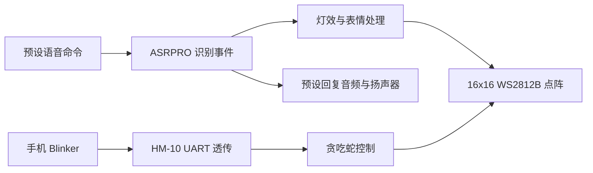

# Intelligent Lighting Control System — Basic

基于 ASRPRO 离线语音、16×16 WS2812B 点阵与 HM-10 蓝牙的灯光交互原型。

**简体中文** · [English](README_EN.md) · [日本語](README_JA.md)

**深入阅读：** [功能与源码](docs/technical-notes.zh-CN.md#source-map) · [图形与游戏算法](docs/technical-notes.zh-CN.md#graphics) · [实现范围](docs/technical-notes.zh-CN.md#implementation-status) · [烧录与操作](docs/setup.zh-CN.md)

本项目源自电子科技大学《综合课程设计（初阶）》，在同一套灯板平台上探索预设语音命令、灯效与表情展示、音乐片段配合随机灯效，以及手机控制的贪吃蛇游戏。开发结合天问 Block 图形化配置与 C/C++ 应用编程。

这是 **Basic → Mid → Pro** 三阶段项目的初阶：Basic 建立离线命令、点阵显示及串口交互基础，后续阶段见 [Mid](https://github.com/DongFengPo1412/Intelligent-Lighting-Control-System-Mid) 与 [Pro](https://github.com/DongFengPo1412/Intelligent-Lighting-Control-System-Pro)。

[观看课程项目演示视频](https://www.bilibili.com/video/BV1Y5N4zxEPX)。仓库保留各功能的开发工程，所选文件的功能范围与演示版本对应关系见[版本说明](docs/technical-notes.zh-CN.md#implementation-status)。

## 硬件与交互结构

样机采用 ASRPRO v2.0 开发板、麦克风与外接扬声器，四块 8×8 WS2812B 点阵拼成 16×16、共 256 颗 LED。HM-10 经 UART 与主控通信，手机使用 Blinker 按钮发送控制字符。

系统由电脑 USB 供电。主控和连线放入购入的木质收纳盒，灯板位于透明盖板下，并为 USB 线加工了出线缺口。具体模块电源、信号电平及连接方法见[操作指南](docs/setup.zh-CN.md#hardware)。

图示概括各功能的输入输出关系，不表示全部归档程序已合并或并发运行。语音功能在设备运行时离线，不需要先连接手机；蓝牙配对是手机控制路径的前提。

## 功能与实现方式

| 功能 | 实现方式 | 对应资料 |
| :--- | :--- | :--- |
| **离线语音交互** | 配置唤醒词、命令词与固定回复，经工具生成资源、编译下载后触发指定事件。 | 各 `.hd` 的词条与 `ASR_CODE`；运行时不接入大模型。 |
| **语音控制灯效** | 用图形积木绑定红、绿、蓝及彩虹、呼吸、流水等 SDK 灯效。 | `功能二.hd`、`功能2.hd`。 |
| **音乐与随机灯光** | 团队将音乐片段替换为预设回复音频；灯柱高度与颜色由随机数生成。 | `功能三.hd`；没有音频频谱、响度或节拍分析。 |
| **表情与像素图案** | 自编二值点阵、预设帧动画及 RGB 图案，实现笑脸、哭脸、四色表情轮播与像素角色。 | `最终版本.hd`；RGB 角色为静态图案。 |
| **蓝牙贪吃蛇** | `E` 启动，`W/S/A/D` 控制方向；实现穿墙、食物避让、碰撞及计分。 | `贪吃蛇.hd`；归档版将分数输出到串口。 |

根据团队演示回忆，游戏还支持语音启动及灯板数字计分；这两项尚未在已归档游戏代码中找到对应实现，复现前需补齐演示版本。[功能与版本对应](docs/technical-notes.zh-CN.md#source-map)

## 主要工程设计

- **配置与应用分工：** 语音资源和常用灯效由天问 Block／SDK 提供；团队编写事件绑定、表情位图、游戏逻辑及串口交互。
- **低分辨率图形：** 用 16 行位掩码存储二值图案，单帧 32 字节；RGB 三通道图案占 768 字节。分块映射将逻辑交点转换为四块 8×8 面板的灯珠索引。
- **输入与游戏更新分离：** 贪吃蛇使用 UART 接收任务和游戏更新任务，接收循环延时 2 ms、游戏循环延时 300 ms。该设计使输入接收不必等到每次游戏更新，但不等于已测得 2 ms 端到端延迟。
- **可见交互反馈：** 用表情切换、蛇头／蛇身／食物配色、自碰撞三次红闪与计分反馈展示状态。

[算法、公式与设计取舍](docs/technical-notes.zh-CN.md#graphics) · [游戏与串口机制](docs/technical-notes.zh-CN.md#game)

## 实物展示与验证范围

| 灯效实拍 | 表情点阵实拍 |
| :---: | :---: |
|  |  |

项目完成了课程功能演示，团队反馈常规展示时可稳定操作；没有进行受控的识别率、延迟、通信距离、电流或长期运行评测，因此本页不提供此类量化成绩。

Basic 的实际边界包括预设词条和回复、程序内固定亮度设置、近距离蓝牙通信，以及不分析音频的随机灯效。归档源码的编译／索引问题和版本差异集中列于[技术说明](docs/technical-notes.zh-CN.md#implementation-status)。

## 快速开始

1. 安装天问 Block 的 ASRPRO 开发环境及对应 USB 串口驱动。
2. 按需要选择[具体功能工程](docs/setup.zh-CN.md#programs)，核对灯珠数量、引脚、词条与串口配置。
3. 生成或准备语音资源，完成编译后下载到实际板卡；需要音乐演示时另配回复音频。
4. 按[分程序操作指南](docs/setup.zh-CN.md#operation)测试；编译前先核对该版本的已知问题。

## 团队、演进与许可

本页介绍团队课程成果，仓库由 **刘超然 / Chaoran Liu** 维护。成员名单与具体模块分工待核对后补充；本页暂不认定某个模块由个人独立完成。

后续整理重点是找回统一演示版本、明确模式退出与游戏计分路径、修正归档代码问题，并补充实际测试记录。Basic 的固定命令与随机灯效也为后续阶段的交互与音频处理升级提供了问题背景。

[技术说明](docs/technical-notes.zh-CN.md) · [烧录与操作](docs/setup.zh-CN.md) · [Mid](https://github.com/DongFengPo1412/Intelligent-Lighting-Control-System-Mid) · [Pro](https://github.com/DongFengPo1412/Intelligent-Lighting-Control-System-Pro)

本仓库应用代码采用 [MIT 许可证](LICENSE)。天问 Block、ASRPRO SDK、第三方硬件资料及音频／图案资源分别遵循其来源的授权条件。
