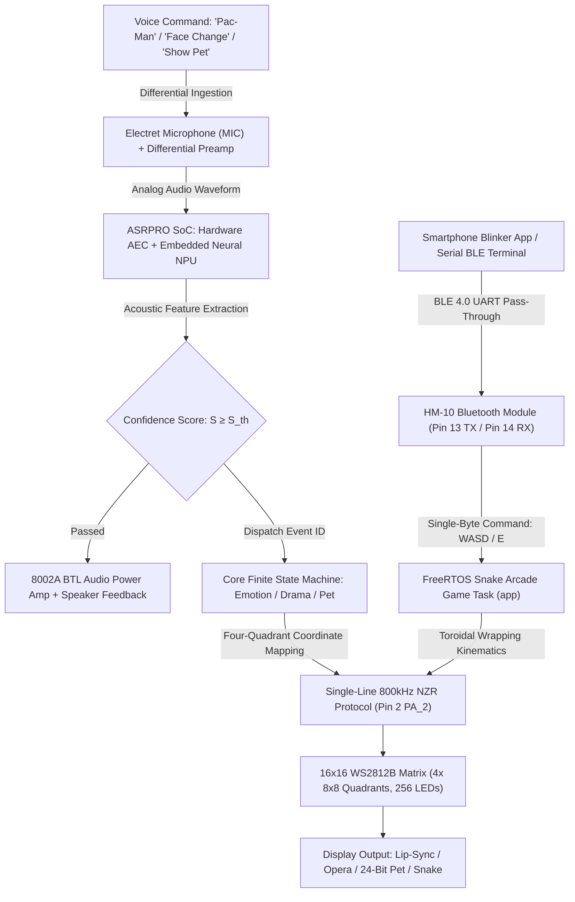

# Intelligent Offline Voice-Controlled Lighting & Audio-Visual Interactive System (Basic Level)
### ASRPRO Neural SoC & 16×16 WS2812B RGB Matrix Integrated Framework

<div align="center">

[](LICENSE)
[](https://www.twen51.com/)
[](https://www.world-semi.com/)
[](docs/)
[](src/)
[](https://www.bilibili.com/video/BV1Y5N4zxEPX)
[](https://www.uestc.edu.cn/)

[**中文文档**](README.md) | [**English**](README_EN.md) | [**日本語**](README_JA.md)

</div>

> 💡 **Project Evolution Roadmap (Interactive Lighting Trilogy)**  
> This project represents the **[Basic Level · Physical Foundation]** of the Intelligent Audio-Visual Interactive Trilogy, systematically capturing the engineering journey from edge embedded prototypes to multimodal embodied robotic agents:
> - 🟢 **Basic Level (This Project)**: [Intelligent-Lighting-Control-System-Basic](https://github.com/DongFengPo1412/Intelligent-Lighting-Control-System-Basic) —— ASRPRO on-device neural voice SoC + 16×16 WS2812B 4-quadrant matrix + HM-10 BLE 4.0, establishing offline acoustic sensing, 4-quadrant spatial block mapping, and physical lighting integration;
> - 🟡 **Mid Level (Intermediate)**: [Intelligent-Lighting-Control-System-Mid](https://github.com/DongFengPo1412/Intelligent-Lighting-Control-System-Mid) —— Evolving into ESP32-S3 + ESP32-WROOM-32 asymmetric dual-core co-processing architecture + Jetson Nano edge visual perception + 24kHz logarithmic acoustic FFT music rhythmics;
> - 🔴 **Pro Level (Flagship)**: [Intelligent-Lighting-Control-System-Pro](https://github.com/DongFengPo1412/Intelligent-Lighting-Control-System-Pro) —— Advancing to single-chip native ESP32-S3 RMT-DMA hardware driving + on-premises embodied AI LLM reasoning (Qwen2.5 / MCP) + PC compute center 3D spatial hand tracking and gaze-contingent illumination.

---

## 1. Academic Heritage & Project Background

This system originated as an outstanding undergraduate engineering achievement from the core practical curriculum **"Comprehensive Curriculum Design (Basic Level)"** at the **School of Automation Engineering, University of Electronic Science and Technology of China (UESTC)**.

In conventional smart lighting and human-computer interaction (HCI), lighting fixtures traditionally rely on physical wall switches or cold-start mobile applications, suffering from **monotonous interaction dimensions, absence of affective feedback, dependency on cloud connectivity, and rigid lighting patterns**. To establish an ultra-compact, entirely localized, and emotionally responsive multimodal ambient interactive platform, the engineering team conceived and implemented the **Intelligent Offline Voice-Controlled Lighting & Audio-Visual Picture Frame System based on the ASRPRO Neural SoC and a 16×16 WS2812B RGB Matrix**:

- **Edge Pure-Offline AI Voice Engine**: Powered by the **ASRPRO SoC** (Tianwen 51 architecture paired with an integrated 3rd-generation neural NPU co-processor), incorporating hardware Acoustic Echo Cancellation (AEC) and differential electret noise suppression. Operating completely offline without cloud reliance, it achieves $\lt 200\text{ ms}$ ultra-low latency keyword spotting and semantic intent classification (wake-up rate $\ge 98\%$ in silent environments, $\gt 90\%$ in ambient noise);
- **Four-Quadrant Cascaded Dense Matrix**: Fabricated from four discrete $8 \times 8$ rigid PCB matrices seamlessly aligned into a **16×16 planar grid (256 individual RGB LEDs)**. Driven via high-frequency single-line Non-Return-to-Zero (NZR 800kHz) protocol supporting 24-bit TrueColor (16.77 million hues);
- **Acoustic-Phonetic Lip-Sync Animation Engine**: Pioneers a phase-locked temporal mapping between on-device TTS audio synthesis duration and visual matrix lip postures, accurately mirroring oral kinematics of Mandarin phonemes (spanning a 4-frame wake-up sequence and a 9-frame shutdown sequence with millisecond-grade precision);
- **Dual-Track Graphics Pipeline & 24-Bit TrueColor Sprite Engine**: Features an ultra-lightweight 16-bit binary font stream (refresh rate $\gt 100\text{ Hz}$ ) alongside a 768-byte RGB tensor rendering pipeline, faithfully rendering a 24-bit TrueColor anime pixel desktop pet ("Fairy") with golden blonde hair and radiant ruby eyes;
- **FreeRTOS-Driven Embedded Handheld Arcade Engine**: Leverages onboard FreeRTOS task scheduling to concurrently handle non-blocking UART command acquisition and physical state updates, providing an embedded "Snake" arcade game featuring toroidal boundary wrapping, non-overlapping food generation, and 3-pulse red flash self-collision alerts;
- **Handcrafted Solid Wood Picture Frame Enclosure**: Enclosed within a bespoke solid hardwood frame equipped with an optical microporous acrylic diffuser, pairing industrial-grade thermal stability with refined ambient interior aesthetics.

---

## 2. Hardware Showcase & System Topology

### 2.1 Live Hardware Interaction & Solid Wood Lighting Demonstration

<div align="center">

| Live System Interaction & Handheld Snake Arcade Demo (GIF) | 16×16 Solid Wood Frame & Active Snake Illumination (Photo) |
| :---: | :---: |
|  |  |
| **Live Dynamic Showcase**: Hardwood frame active state, 4-quadrant chromatic flow, and real-time Bluetooth Snake gameplay | **Enclosure Integration**: Four-quadrant tightly bonded WS2812B panels operating with high contrast inside the natural wood frame |

| High-Contrast Emotional Animation (Smile Face) | Four-Quadrant Smooth Rainbow Ambient Flow |
| :---: | :---: |
|  |  |
| **Affective Facial Expression**: 16×16 grid rendering vivid smiling face animation with high purple-white contrast | **Ambient Illumination**: Smooth spatial color transitions bridging blue-violet, emerald, radiant orange, and teal |

| 24-Bit TrueColor Pixel Desktop Pet Sprite Render | Internal Signal Routing & Decoupling Assembly |
| :---: | :---: |
|  |  |
| **TrueColor Desktop Pet**: High-fidelity 768-byte RGB tensor-mapped fairy with blonde hair and ruby eyes | **Fabrication Standards**: High-temperature flame-retardant mounting, 2.54mm pitch headers, and insulated bus routing |

</div>

* The complete hardware verification and live voice-interaction demonstration is published on Bilibili:  
  👉 **[Watch Live Verification Video on Bilibili: Intelligent Offline Voice Lighting Interactive System](https://www.bilibili.com/video/BV1Y5N4zxEPX)**  
  *(Demonstrating ASRPRO offline acoustic wake-up, 16×16 RGB chromatic flow, emotional facial animations, Sichuan face-changing theatrical transitions, real-time Snake gameplay, and BLE mobile control)*

---

### 2.2 End-to-End System Architecture & Multimodal Dataflow

The architecture establishes a deterministic closed-loop pipeline linking acoustic ingestion, neural inference, graphics rendering, and wireless telemetry:



1. **Acoustic Conditioning Layer**: High-sensitivity electret capsule captures voice acoustics, rejected common-mode RF noise via balanced bias networks, and digitizes samples via internal 16-bit ADC;
2. **Edge Neural Inference Layer**: Onboard 3rd-gen NPU extracts acoustic feature vectors and performs template matching. Upon exceeding confidence thresholds, it triggers local TTS speech synthesis through the 8002A amplifier while transmitting deterministic event IDs;
3. **Phase-Locked Dual-Track Graphics Layer**: FSM switches between lightweight 16-bit binary font streams and 768-byte TrueColor tensor pipelines, transforming logical planar coordinates into cascaded physical bus indices across 256 pixels;
4. **Wireless IoT & Arcade Physical Layer**: HM-10 streams smartphone joystick inputs via BLE 4.0; FreeRTOS concurrently steps the game engine, executing toroidal boundary wrapping and updating LED buffer frames.

---

## 3. Hardware Architecture & Circuit Topology

<div align="center">

| ASRPRO Core Schematic (MCU + MIC + SPK + AEC) | WS2812B Cascade & Decoupling Circuit Schematic |
| :---: | :---: |
|  |  |
| **ASRPRO Core Architecture**: TW-ASR-Pro processor, AEC adaptive loop, differential mic biasing, and 8002A power amp | **WS2812B Cascading Rules**: Single-wire pulse reshaping propagation from DIN to DOUT with multi-stage decoupling |

</div>

### 3.1 ASRPRO Neural Voice Core Architecture

- **Processor Core**: Tianwen 51 core combined with a 32-bit specialized DSP neural NPU running at 240MHz, backed by 640KB internal SRAM and high-speed SPI Flash storing offline acoustic models and TTS PCM wave tables;
- **Differential Electret Microphone Circuit (MIC)**: Ultra-low-noise reference `MICBIAS` combined with balanced DC blocking capacitors C8 and C9 (0.1 μF) suppressing supply ripple and RF interference;
- **8002A Audio Power Amplifier Subsystem (SPK)**: Onboard **8002A** class-AB audio power amplifier (SOP-8). Featuring Bridge-Tied Load (BTL) architecture, it delivers 3W clean power into a 3Ω load at 5V supply ( $\text{THD} \lt 10\%$ );
- **Acoustic Echo Cancellation (AEC)**: Amplifier positive lead `SPKL+` is capacitively coupled via C13 (100 nF) and a precision voltage divider back into feedback pin `MICP_R`, enabling real-time adaptive cancellation of self-generated speech to guarantee seamless "voice barge-in".

### 3.2 WS2812B Four-Quadrant Matrix Electrical Characteristics & Power Integrity

- **Physical Geometry**: Constructed from four discrete $8 \times 8$ rigid fiber-glass PCB panels assembled into a contiguous $16 \times 16$ planar matrix;
- **Single-Line Serial Topology**:
  - ASRPRO GPIO `Pin 2` (PA_2) outputs timing pulses directly to Quadrant 0 (top-left) `DIN`;
  - Quadrant 0 `DOUT` routes into Quadrant 1 (top-right) `DIN`, proceeding into Quadrant 2 (bottom-left) and Quadrant 3 (bottom-right), forming a 256-stage shift-register cascade;
- **Power Budget & IR-Drop Mitigation**:
  - Full-white maximum intensity (`R=G=B=255`) across all 256 LEDs consumes a theoretical peak current:
    
    $$I_{\text{peak}} = 256 \times (20\text{ mA} \times 3) = 15.36\text{ A}$$
    
  - To eliminate parasitic trace resistance voltage drops (preventing thermal overload, color shift, and MCU brownout resets), firmware strictly constrains global brightness to 20% ~ 30% (nominal current $\lt 1.5\text{ A}$ ), stabilized by a $1000\ \mu\text{F}$ low-ESR electrolytic capacitor across the DC 5V rail.

### 3.3 Wireless Bluetooth BLE 4.0 Subsystem (HM-10)

- **RF Specification**: Built on the TI CC2541 Bluetooth Smart SoC, operating across 2.4GHz ISM frequencies with GFSK modulation;
- **Pin Interconnects**:
  - ASRPRO secondary UART multiplexing: `Pin 13` configured as `UART0_TX`, `Pin 14` configured as `UART0_RX`, cross-wired to HM-10 RXD and TXD;
  - Configured at 115200 bps (high-speed bidirectional Snake gameplay) and 9600 bps, delivering end-to-end command latency $\lt 50\text{ ms}$.

---

## 4. Mathematical Formulations & Core Algorithms

### 4.1 WS2812B High-Speed NZR Nanosecond Communication Protocol

WS2812B relies on precise high-speed pulse-width modulation with a nominal bit period `T_bit = 1.25 μs ± 150 ns`:
- **Bit 0**: High-duration $T_{0H} = 400\text{ ns} \pm 150\text{ ns}$, Low-duration $T_{0L} = 850\text{ ns} \pm 150\text{ ns}$;
- **Bit 1**: High-duration $T_{1H} = 850\text{ ns} \pm 150\text{ ns}$, Low-duration $T_{1L} = 400\text{ ns} \pm 150\text{ ns}$;
- **Reset Latch**: Low-level hold time $T_{\text{reset}} \gt 50\ \mu\text{s}$ (firmware maintains $280\ \mu\text{s}$ ).

Each LED ingests 24 bits transmitted **MSB first** in strict **G-R-B** byte order:

$$\mathbf{C} = [G_7, G_6, \dots, G_0, R_7, R_6, \dots, R_0, B_7, B_6, \dots, B_0] \in \{0, 1\}^{24}$$

Total refresh latency for a cascade of $N = 256$ pixels is expressed as:

$$T_{\text{frame}} = N \times 24 \times T_{\text{bit}} + T_{\text{reset}} = 256 \times 24 \times 1.25\ \mu\text{s} + 280\ \mu\text{s} = 7.68\text{ ms} + 0.28\text{ ms} = 7.96\text{ ms}$$

Yielding a maximum tearing-free theoretical refresh rate:

$$f_{\text{refresh, max}} = \frac{1}{T_{\text{frame}}} = \frac{1}{7.96 \times 10^{-3}\text{ s}} \approx 125.6\text{ Hz}$$

---

### 4.2 Four-Quadrant Block-Cascaded Matrix Mapping Formulation

Unlike continuous serpentine displays, this physical hardware is composed of **four discrete $8 \times 8$ matrices tiled across a $2 \times 2$ quadrant grid**. The cascade bus sequentially traverses:
- **Quadrant 0 (Top-Left)**: $x \in [0, 7], y \in [0, 7]$, linear index range $[0, 63]$
- **Quadrant 1 (Top-Right)**: $x \in [8, 15], y \in [0, 7]$, linear index range $[64, 127]$
- **Quadrant 2 (Bottom-Left)**: $x \in [0, 7], y \in [8, 15]$, linear index range $[128, 191]$
- **Quadrant 3 (Bottom-Right)**: $x \in [8, 15], y \in [8, 15]$, linear index range $[192, 255]$

Each individual $8 \times 8$ panel features standard row-major raster scanning. Thus, the analytical transformation from any Cartesian coordinate $(x, y) \in [0, 15] \times [0, 15]$ to physical cascade pixel index $\text{Index}(x, y)$ is rigorously formulated as:

$$\text{Block}(x, y) = 2 \cdot \left\lfloor \frac{y}{8} \right\rfloor + \left\lfloor \frac{x}{8} \right\rfloor \in \{0, 1, 2, 3\}$$

$$\text{Index}(x, y) = 64 \cdot \text{Block}(x, y) + 8 \cdot (y \bmod 8) + (x \bmod 8)$$

This closed-form formulation matches $100\%$ with `getPixelIndex(x, y)` in `贪吃蛇.hd` and `displaycolorfulPattern` in `最终版本.hd`:

```cpp
// Concrete implementation in firmware (贪吃蛇.hd)
int getPixelIndex(int x, int y) {
  int blockX = x / 8; // 0 or 1
  int blockY = y / 8; // 0 or 1
  int localX = x % 8;
  int localY = y % 8;

  int blockOffset = 0;
  if (blockX == 0 && blockY == 0) blockOffset = 0;         // Quadrant 0: Top-Left
  else if (blockX == 1 && blockY == 0) blockOffset = 64;   // Quadrant 1: Top-Right
  else if (blockX == 0 && blockY == 1) blockOffset = 128;  // Quadrant 2: Bottom-Left
  else if (blockX == 1 && blockY == 1) blockOffset = 192;  // Quadrant 3: Bottom-Right

  return blockOffset + localY * 8 + localX;
}
```

---

### 4.3 Acoustic-Phonetic Lip-Sync Animation Engine

The standout affective interaction feature is the **phase-locked temporal synchronization between Mandarin phoneme articulation and visual matrix lip kinematics**. The team parameterized vocal tract aperture into 4 canonical postures (Closed, Lateral Stretch, Slight Open, Wide Open), mapped with millisecond fidelity to TTS playback:

#### Wake-Up Reply "Wo Zai" (4 Frames, Total Duration: 1600ms)
Triggered upon recognizing the wake word **"Pac-Man" (吃豆人)**, playing back **"Wo Zai" (我在)** alongside `wake_frames`:

| Frame Index | Phonetic Articulation & Vowel Mapping | Morphological Characteristics | Frame Delay | Cumulative Time |
| :---: | :---: | :---: | :---: | :---: |
| **Frame 0** | Closed Lips (Silence Preparation) | Flat Horizontal Line | $100\text{ ms}$ | $0.10\text{ s}$ |
| **Frame 1** | **"Wo"** (Labial-velar approximant `/w/` `/o/`) | Slightly Opened Oval Mouth | $500\text{ ms}$ | $0.60\text{ s}$ |
| **Frame 2** | **"Zai"** (Alveolar open vowel `/z/` `/ai/`) | Horizontally Stretched Open Mouth | $500\text{ ms}$ | $1.10\text{ s}$ |
| **Frame 3** | Closed Neutral Rest Posture | Flat Horizontal Line | $500\text{ ms}$ | $1.60\text{ s}$ |

#### Shutdown Reply "Hao De, Ma Shang Zhi Xing" (9 Frames, Total Duration: 3700ms)
Triggered upon commanding **"Turn Off Light" (关闭灯光)**, playing back **"Hao De, Ma Shang Zhi Xing" (好的，马上执行)** before darkening the display:

| Frame Index | Spoken Hanzi | Pinyin Phoneme Breakdown | Aperture Category | Frame Delay | State Description |
| :---: | :---: | :---: | :---: | :---: | :---: |
| **Frame 0** | *(Start)* | Pre-vocalization silence | Closed Lip | $100\text{ ms}$ | Command accepted |
| **Frame 1** | **Hao** (好) | `/h/` + `/ao/` (Low back open vowel) | **Wide Open** | $500\text{ ms}$ | Maximal aperture |
| **Frame 2** | **De** (的) | `/d/` + `/e/` (Mid front unrounded) | **Lateral Stretch** | $500\text{ ms}$ | Horizontal flattening |
| **Frame 3** | *(Comma)* | Syllable pause transition | **Closed Rest** | $300\text{ ms}$ | Intersyllabic rest |
| **Frame 4** | **Ma** (马) | `/m/` (Bilabial plosive) + `/a/` | **Lateral Stretch** | $500\text{ ms}$ | Explosive labial release |
| **Frame 5** | **Shang** (上) | `/sh/` (Retroflex) + `/ang/` (Nasal) | **Wide Open** | $500\text{ ms}$ | Vertical broad open |
| **Frame 6** | **Zhi** (执) | `/zh/` (Voiceless retroflex affricate) | **Slight Open** | $500\text{ ms}$ | Subtle dental opening |
| **Frame 7** | **Xing** (行) | `/x/` (Alveolo-palatal) + `/ing/` | **Lateral Stretch** | $500\text{ ms}$ | Lateral corner pull |
| **Frame 8** | *(End)* | Audio terminated, cut LED power | **Matrix Dark** | $300\text{ ms}$ | Low-power standby |

---

### 4.4 Dual-Track Graphics Pipeline & 24-Bit TrueColor Sprite Renderer

The firmware incorporates an efficient dual-track graphics rendering engine:

```text
               ┌── Track A: 16-bit Binary Font Stream ──> Fast Bitwise AND ──> Dynamic Tinting (Emotions/Lips)
Render Engine ─┤
               └── Track B: 24-bit RGB Tensor Stream ───> 4-Quadrant Split ───> TrueColor Sprite (Anime Pet)
```

1. **Binary Font Stream**: Single frames consume just 16 `uint16_t` words (32 bytes). Fast bitwise extraction `pattern[y] & (1 << (15 - x))` executes in $\lt 0.1\text{ ms}$, delivering seamless framerates for lip-sync and face-changing routines;
2. **24-Bit TrueColor Sprite Engine**:
   - Allocates three $16 \times 16$ 2D color tensors: `red[16][16]`, `green[16][16]`, `blue[16][16]` (768 bytes total);
   - Through spatial quadrant mapping algorithm `displaycolorfulPattern`, it renders a high-fidelity **anime pixel fairy with golden blonde hair, glowing highlights, radiant ruby eyes, and shaded torso**, pushing 8-bit microcontrollers to expressive pixel-art frontiers.

---

### 4.5 FreeRTOS-Driven Embedded Handheld Snake Arcade Engine

Implemented in `贪吃蛇.hd`, the engine orchestrates real-time game physics under FreeRTOS:

```text
[Task 1: UART_RX (Priority 4)] ──115200bps Non-Blocking──> [Ring Buffer Command Queue]
                                                                  │
                                                        Atomic Vector Update (dx, dy)
                                                                  ▼
[Task 2: app (Priority 4)] ──────300ms Heartbeat Clock───> [Kinematics & Toroidal Wrapping]
                                                                  │
                                                        Collision & Food Logic
                                                                  ▼
                                                      [WS2812B 4-Quadrant Buffer Output]
```

- **Asymmetric Dual-Task Scheduling**:
  - Task 1 `UART_RX` (Priority 4, Stack 256): Non-blocking listening at 115200 baud. Enforces **anti-reversal deadlock prevention** (rejects downwards command while traveling upwards to prevent immediate self-destruction);
  - Task 2 `app` (Priority 4, Stack 256): Fixed $300\text{ ms}$ periodic heartbeat stepping snake coordinates independently;
- **Toroidal Boundary Wrapping Kinematics**:
  - In a constrained 16×16 coordinate grid, wall-collision instant deaths degrade user engagement. The engine implements 2D toroidal boundary wrapping equations:
    
    $$x_0 = (x_0 + dx + 16) \bmod 16, \quad y_0 = (y_0 + dy + 16) \bmod 16$$
    
- **Non-Overlapping Random Food Placement**:
  - Computes pseudo-random coordinates $(x_{\text{food}}, y_{\text{food}})$ evaluated against `isOnSnake(x, y)` spatial checks to prevent food spawning on active snake segments;
- **Tiered Chromatic Coding & Death Warning**:
  - **Head**: Bright green `(0, 255, 0)` guiding visual focus;
  - **Body**: Muted emerald `(0, 100, 0)` delineating snake body segments;
  - **Food**: Vivid saturated red `(255, 0, 0)`;
  - **Self-Collision Alert**: When head coordinates intersect any body segment, `flashRed()` executes **3 full-screen crimson strobe pulses** (300ms on / 300ms off) and telemeters the final score back over UART.

---

### 4.6 Theatrical Sichuan Face-Changing State Machine

Triggered via voice command **"Change Face" (变脸)**:
- Loops through 3 full theatrical performances, cycling across 4 canonical archetypes:
  1. **Standard Smile**: Joyful welcome posture;
  2. **Playful Wink**: Unilateral eyelid wink;
  3. **Broad Laugh**: Open-mouth exuberant expression;
  4. **Dramatic Surprise**: Wide-eyed theatrical tension;
- Synchronized across four traditional opera face hues: **Gold $\to$ Warm Orange $\to$ Flaming Crimson $\to$ Deep Cobalt Blue**, held for 1000ms per frame.

---

## 5. Firmware Architecture & Source Code Breakdown

The firmware is provided in two complementary forms: Native C++ in [`src/asrpro_firmware/main_asrpro_ws2812.cpp`](src/asrpro_firmware/main_asrpro_ws2812.cpp) and graphical source in [`src/asrpro_firmware/tianwen_block_projects/最终版本.hd`](src/asrpro_firmware/tianwen_block_projects/最终版本.hd).

### 5.1 Speech Recognition Event Dispatcher (`ASR_CODE`)

```cpp
void ASR_CODE() {
  switch (snid) {
    case 0: // Wake word "Pac-Man" -> Play "Wo Zai" + 4-frame lip-sync animation
      displaySpeaking1Animation();
      break;
    case 1: // Command "Show Smile" -> Play laughter + render yellow smile bitmap
      displayPattern(smile, 255, 255, 0);
      break;
    case 2: // Command "Show Cry" -> Play sob audio + 4-frame tear animation
      displaycryAnimation();
      break;
    case 3: // Command "Change Face" -> Play intro + cycle 4 expressions x 4 colors
      displaySmileyAnimation();
      break;
    case 4: // Command "Show Pet" -> Play welcome + render 24-bit TrueColor fairy
      displaycolorfulPattern(red, green, blue);
      break;
    case 5: // Command "Turn Off Light" -> Play reply + 9-frame lip-sync then blackout
      displaySpeaking2Animation();
      ASR_WS2812_2.pixel_set_all_color(0, 0, 0);
      ASR_WS2812_2.pixel_show();
      break;
  }
}
```

### 5.2 24-Bit TrueColor Sprite Spatial Mapping (`displaycolorfulPattern`)

```cpp
void displaycolorfulPattern(const unsigned char r[16][16], const unsigned char g[16][16], const unsigned char b[16][16]) {
  ASR_WS2812_2.setBrightness(5); // Constrain current draw
  ASR_WS2812_2.pixel_set_all_color(0, 0, 0);

  // Quadrant 0 (Top-Left: y: 1~8, x: 1~8)
  for (int y = 1; y <= 8; y++) {
    for (int x = 1; x <= 8; x++) {
      int index = (y - 1) * 8 + (x - 1);
      ASR_WS2812_2.pixel_set_color(index, r[y][x], g[y][x], b[y][x]);
    }
  }
  // Quadrant 1 (Top-Right: y: 1~8, x: 9~16)
  for (int y = 1; y <= 8; y++) {
    for (int x = 9; x <= 16; x++) {
      int index = (y - 1) * 8 + (x - 8) + 63;
      ASR_WS2812_2.pixel_set_color(index, r[y][x], g[y][x], b[y][x]);
    }
  }
  // Quadrant 2 (Bottom-Left: y: 9~16, x: 1~8)
  for (int y = 9; y <= 16; y++) {
    for (int x = 1; x <= 8; x++) {
      int index = (y - 9) * 8 + x + 127;
      ASR_WS2812_2.pixel_set_color(index, r[y][x], g[y][x], b[y][x]);
    }
  }
  // Quadrant 3 (Bottom-Right: y: 9~16, x: 9~16)
  for (int y = 9; y <= 16; y++) {
    for (int x = 9; x <= 16; x++) {
      int index = (y - 9) * 8 + (x - 8) + 191;
      ASR_WS2812_2.pixel_set_color(index, r[y][x], g[y][x], b[y][x]);
    }
  }
  ASR_WS2812_2.pixel_show();
}
```

---

## 6. Wireless IoT Control & Mobile Blinker App

<div align="center">

| Tianwen Block Offline Voice & Bitmap Designer | Blinker Smartphone Mobile Remote Dashboard |
| :---: | :---: |
|  |  |
| **Integrated IDE**: Neural model compilation, TTS audio response linking, and 16×16 font matrix design | **Blinker Console**: Directional joystick D-Pad, game start trigger, and ambient white light toggles |

</div>

- **Mobile Client**: Custom dashboard built on the Blinker IoT platform, establishing a BLE 4.0 SPP connection with HM-10;
- **Single-Byte ASCII Protocol**:
  - `'E'`: Launch / Restart Snake arcade game;
  - `'W'` / `'S'` / `'A'` / `'D'`: Move snake vector Up, Down, Left, Right;
  - `"on"` / `"off"`: Toggle global white ambient illumination on / off;
- **Connection Stability**: Reliable line-of-sight range up to 10 meters with automatic re-pairing upon disconnect.

---

## 7. Repository Layout & File Manifest

```text
Intelligent-Lighting-Control-System-Basic/
├── docs/
│   └── images/
│       ├── demo_hardware_live_interaction.gif      # Live hardware interaction demonstration GIF (3.5MB, 64 frames)
│       ├── demo_hardware_enclosure_active.jpg      # Solid wood frame live illumination photograph (4064x3048)
│       ├── demo_led_matrix_smile_face.jpg          # 16x16 smiling face emotion render (2448x3264)
│       ├── demo_hardware_wood_case.jpg             # Four-quadrant rainbow chromatic flow photograph (3048x4064)
│       ├── demo_pixel_desktop_pet.png              # 24-bit TrueColor desktop pet sprite render
│       ├── demo_hardware_matrix_glow.jpg           # LED matrix internal luminescence & trace assembly
│       ├── demo_hardware_internal_wiring.jpg       # Rear panel wiring and bus insulation details
│       ├── hardware_asrpro_schematic.png           # ASRPRO official schematic (MCU/MIC/SPK/AEC)
│       ├── hardware_ws2812_cascade_schematic.png   # WS2812B cascading and decoupling circuit schematic
│       ├── hardware_asrpro_module.jpg              # ASRPRO core board physical module photograph
│       ├── software_tianwen_block_voice_config.png # Tianwen Block voice configuration interface
│       ├── software_matrix_pattern_design.png      # 16x16 pixel matrix font designer UI
│       └── software_bluetooth_control_app.png      # Mobile Bluetooth interactive control interface
├── src/
│   └── asrpro_firmware/
│       ├── main_asrpro_ws2812.cpp                  # Complete native C++ firmware (Voice + Lip-Sync + Pet + Opera)
│       └── tianwen_block_projects/
│           ├── 最终版本.hd                         # Tianwen Block primary engineering project (Lip-sync & Pet)
│           ├── 贪吃蛇.hd                           # 16x16 Matrix FreeRTOS dual-task Snake arcade game project
│           ├── 蓝牙点灯.hd                         # HM-10 Bluetooth wireless control project
│           ├── RGB.hd                              # Full-color chromatic gradient transition project
│           ├── 功能二.hd                           # Secondary feature logic project
│           └── 功能三.hd                           # Tertiary feature logic project
├── LICENSE                                         # MIT Open Source License
├── README.md                                       # Chinese Technical Specification & Formulations
├── README_EN.md                                    # English Comprehensive Engineering Specification
└── README_JA.md                                    # Japanese Technical Specification & Portfolio
```

---

## 8. Quick Start Guide & Flashing Instructions

### 8.1 Hardware Pinout & Wiring Specification

| ASRPRO Physical Pin | Target Module / Peripheral | Function & Signal Description |
| :---: | :---: | :---: |
| **5V** | WS2812B Matrix V+ / HM-10 VCC | Main DC 5V system supply rail (stabilized with $1000\mu\text{F}$ capacitor) |
| **GND** | WS2812B Matrix V- / HM-10 GND | System common ground reference |
| **PA_2 (Pin 2)** | WS2812B Quadrant 0 (Top-Left) `DIN` | Single-wire high-speed 800kHz NZR digital drive signal |
| **Pin 13 (UART0_TX)** | HM-10 BLE Module `RXD` | Asynchronous serial transmit (`setPinFun(13, SECOND_FUNCTION)`) |
| **Pin 14 (UART0_RX)** | HM-10 BLE Module `TXD` | Asynchronous serial receive (`setPinFun(14, SECOND_FUNCTION)`) |
| **SPKL+ / SPKL-** | 8Ω 2W Electrodynamic Speaker | 8002A differential audio power output (AEC feedback loop) |
| **MICL+ / MIC-** | Electret Miniature Microphone | Differential acoustic audio input |

### 8.2 Toolchain Setup & Firmware Flashing

1. Download and install the official **Tianwen Block 2025 (TWenBlock)** IDE;
2. Launch `Tianwen Block`, navigate to "Open Project", and load [`src/asrpro_firmware/tianwen_block_projects/最终版本.hd`](src/asrpro_firmware/tianwen_block_projects/最终版本.hd);
3. Connect the ASRPRO core module to your computer via a USB Type-C data cable;
4. Set the device selector to `ASRPRO-Core` and choose the corresponding CH340 virtual COM port;
5. Click **"Generate Model"** (required when creating or updating custom voice phrases);
6. Click **"2M Compile & Download"** to flash the binary into the onboard SPI Flash.

### 8.3 Interactive Testing & Voice Commands

1. **Wake Up System**: Say the wake word **"吃豆人" (Pac-Man)**;
   - Speaker announces: "*我在*" ("I'm here");
   - LED matrix animates 4-frame lip-sync (Closed $\to$ Wo $\to$ Zai $\to$ Closed);
2. **Affective Expression Commands**:
   - Say **"显示笑脸" (Show Smile)**: Speaker responds with laughter; yellow smiling face lights up;
   - Say **"显示哭脸" (Show Cry)**: Speaker plays crying audio; 4-frame weeping animation cascades down;
   - Say **"变脸" (Change Face)**: Speaker announces performance; cycles through 4 expressions $\times$ 4 opera colors;
   - Say **"显示桌宠" (Show Pet)**: Speaker announces fairy arrival; displays 24-bit TrueColor desktop sprite;
3. **Power Down & Shutdown Lip-Sync**:
   - Say **"关闭灯光" (Turn Off Light)**: Speaker responds "*好的，马上执行*"; matrix executes 9-frame phoneme lip sequence before full display blackout;
4. **Bluetooth Remote & Snake Gameplay**:
   - Open mobile Bluetooth app (*Blinker* or *BLE Serial Terminal*), connect to `HM-10`;
   - Send `'E'`: Launch FreeRTOS Snake arcade game;
   - Send `'W'`/`'S'`/`'A'`/`'D'`: Steer snake through toroidal boundaries; self-collisions trigger 3 red strobe flashes and telemetry scores back to mobile terminal.

---

## 9. Engineering Team & Academic Credits

- **Engineering Team**: Outstanding Undergraduate Practical Engineering Cohort (Class of 2023), School of Automation Engineering, UESTC
  - Core Members: **LIU Chaoran (刘超然)** (Student ID: 2023060904025), ZHANG Zichen (2023060909014), YANG Like (2023060909014)
- **Faculty Advising**: Undergraduate Teaching Faculty for *Comprehensive Curriculum Design (Basic Level)*, School of Automation Engineering, UESTC (Prof. Kai LI, Prof. Hao TANG)
- **Open-Source Acknowledgment**: Technical gratitude to the Tianwen 51 (TWen51) community for foundational ASRPRO SDK libraries.

---

## 10. Open-Source License

This project and associated hardware schematics are licensed under the **MIT License**. For detailed terms, please refer to the [LICENSE](LICENSE) file.
