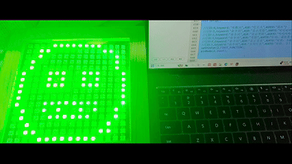
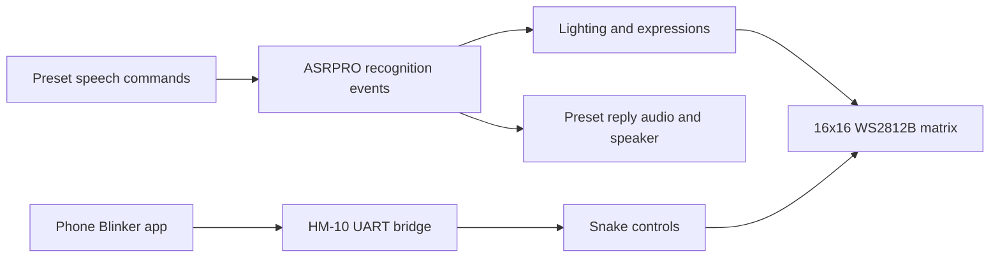
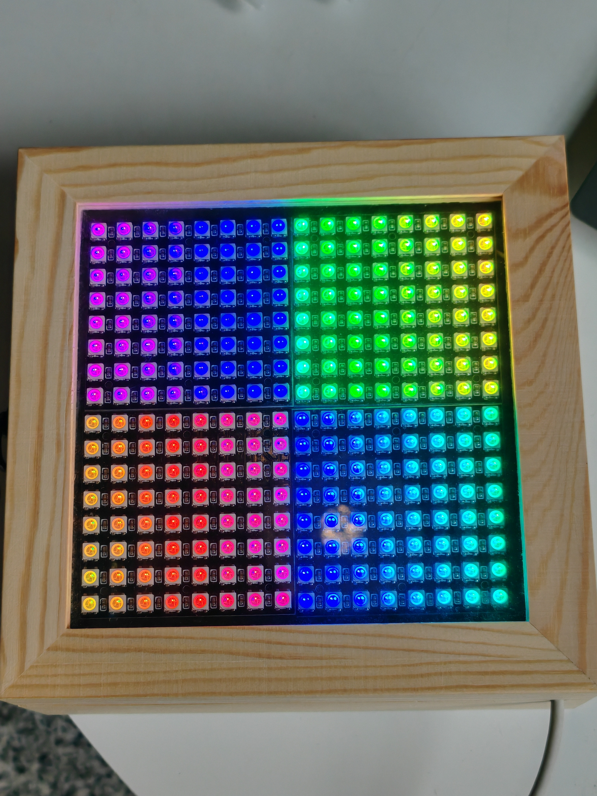
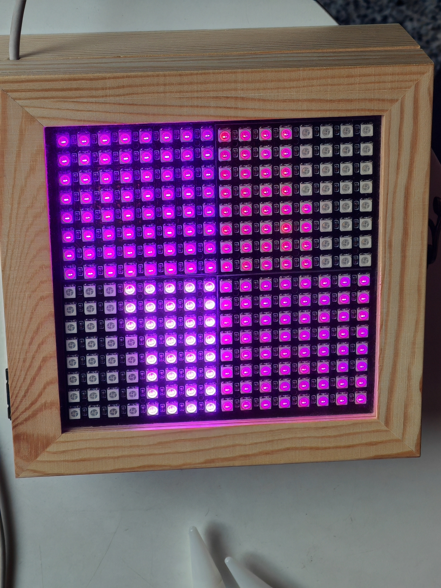

# Intelligent Lighting Control System — Basic

A lighting interaction prototype using ASRPRO offline speech, a 16×16 WS2812B matrix, and HM-10 Bluetooth.

[简体中文](README.md) · **English** · [日本語](README_JA.md)

**Explore:** [Features and source](docs/technical-notes.en.md#source-map) · [Graphics and algorithms](docs/technical-notes.en.md#graphics) · [Implementation scope](docs/technical-notes.en.md#implementation-status) · [Setup and operation](docs/setup.en.md)

Developed for UESTC's introductory comprehensive curriculum design course, Basic explores preset speech commands, lighting and facial patterns, music clips accompanied by random light effects, and a phone-controlled Snake game on a shared LED platform. Development combines Tianwen Block configuration with C/C++ application programming.

This is the first stage of **Basic → Mid → Pro**. Basic establishes offline commands, matrix display, and serial interaction. See [Mid](https://github.com/DongFengPo1412/Intelligent-Lighting-Control-System-Mid) and [Pro](https://github.com/DongFengPo1412/Intelligent-Lighting-Control-System-Pro) for later stages.

[Watch the course demonstration](https://www.bilibili.com/video/BV1Y5N4zxEPX). The repository preserves development projects for individual features. See [version scope](docs/technical-notes.en.md#implementation-status) for each file's coverage and its relation to the demonstration.

## Hardware and interaction paths

The prototype uses an ASRPRO v2.0 board, microphone, and external speaker. Four 8×8 WS2812B panels form a 16×16 matrix with 256 LEDs. An HM-10 communicates with the controller over UART, and phone buttons in Blinker send control characters.

Power comes from a computer USB port. Electronics sit inside a purchased wooden storage box, with the panels beneath a transparent lid and a cutout for the USB cable. Module supplies, signal levels, and connections are covered in the [setup guide](docs/setup.en.md#hardware).

The diagram summarizes feature inputs and outputs; it does not assert that all archived programs are merged or concurrent. Speech operates offline on the device and does not require a phone connection. Bluetooth pairing is required for the phone-control path.

## Features and implementation

| Feature | Implementation | Evidence |
| :--- | :--- | :--- |
| **Offline speech** | Configure wake words, commands, and fixed replies, then generate resources, build, and flash to dispatch events. | Vocabulary and `ASR_CODE` in the projects; no runtime LLM connection. |
| **Voice-controlled lighting** | Graphical blocks bind red/green/blue, rainbow, breathing, and flowing effects supplied by the SDK. | `功能二.hd` and `功能2.hd`. |
| **Music with random lights** | The team replaced a reply audio asset with a fixed music clip; random numbers choose bar heights and colors. | `功能三.hd`; no spectrum, loudness, or beat analysis. |
| **Expressions and pixel art** | Custom binary patterns, frame sequences, and RGB data provide smiles, crying, four-color expression cycles, and a pixel character. | `最终版本.hd`; the RGB character is a static image. |
| **Bluetooth Snake** | `E` starts; `W/S/A/D` change direction. Includes boundary wrapping, food exclusion, collision, and scoring. | `贪吃蛇.hd`; the archived version prints scores to serial. |

The team also recalls voice-start and numeric scores on the LED matrix during the demonstration. Those paths have not been located in the archived game code; reproducing them requires the demonstration version. [Feature/version mapping](docs/technical-notes.en.md#source-map)

## Engineering design

- **Configuration and application work:** Tianwen Block/the SDK provide speech resources and standard effects. Team application work includes event binding, expression bitmaps, game logic, and serial interaction.
- **Compact graphics:** sixteen row masks store a binary frame in 32 bytes; three RGB planes occupy 768 bytes. Block mapping translates logical coordinates into indices across four 8×8 panels.
- **Separate input and game updates:** Snake uses UART reception and game-update tasks, with 2 ms and 300 ms loop delays respectively. Input reception need not wait for each game update; this does not establish a measured 2 ms end-to-end response.
- **Visible state feedback:** expression changes, distinct head/body/food colors, three red flashes after self-collision, and scoring make interaction state visible.

[Algorithms, equations, and tradeoffs](docs/technical-notes.en.md#graphics) · [Game and serial logic](docs/technical-notes.en.md#game)

## Physical examples and validation scope

| Lighting photograph | Matrix expression photograph |
| :---: | :---: |
|  |  |

The project completed a course demonstration, with the team reporting stable operation during normal presentation. No controlled recognition, latency, range, current, or endurance benchmark was recorded, so no such numerical performance is claimed.

Basic uses preset vocabulary/replies, brightness values fixed in the programs, short-range Bluetooth, and random effects without audio analysis. Compilation/indexing issues and differences between archived versions are collected in the [technical notes](docs/technical-notes.en.md#implementation-status).

## Quick start

1. Install Tianwen Block with ASRPRO support and the matching USB serial driver.
2. Choose a [feature project](docs/setup.en.md#programs) and check LED count, pins, vocabulary, and serial settings.
3. Generate or prepare voice resources, build, and flash for the actual board. Supply the reply audio separately for the music demonstration.
4. Follow the [per-program instructions](docs/setup.en.md#operation), reviewing that version's known issues before building.

## Team, development, and license

This page describes a team course project. **Chaoran Liu / 刘超然** maintains the repository. The member list and module responsibilities await confirmation; no module is currently attributed as an individual's sole work.

Next documentation/engineering steps are to recover the combined demonstration version, establish mode exit and score-display paths, resolve archived code issues, and add test records. Fixed commands and simulated music effects provide the problem context for later interaction and audio-processing work.

[Technical notes](docs/technical-notes.en.md) · [Setup and operation](docs/setup.en.md) · [Mid](https://github.com/DongFengPo1412/Intelligent-Lighting-Control-System-Mid) · [Pro](https://github.com/DongFengPo1412/Intelligent-Lighting-Control-System-Pro)

Application code in this repository is under the [MIT License](LICENSE). Tianwen Block, the ASRPRO SDK, third-party hardware documents, and audio/image resources retain their respective licensing terms.

## Maintenance and validation

The 2026-10 revision uses `uint16_t` frame delays in the main C++ and expression .hd files, and zero-based RGB indexing with the original four-panel order. Snake uses bounded free-cell enumeration, ends with serial scoring on a full board, and never appends at array index 256. UART only publishes atomic start/latest-direction requests; the game task owns state and rejects reversal relative to the last committed direction once per tick. This is a latest-value slot, not a command FIFO.

Seven offline cases execute functions extracted from the real .hd source with Clang/WebAssembly: unique pixel mapping, RGB bounds, one/free-no-cell cases, growth to capacity and rapid turns; source delay declarations are also compiled. The complete Tianwen SDK was not built or flashed and hardware was not retested. The target compiler must support GCC/Clang `__atomic` builtins; vendor SDK and task stack behavior remain unverified.
