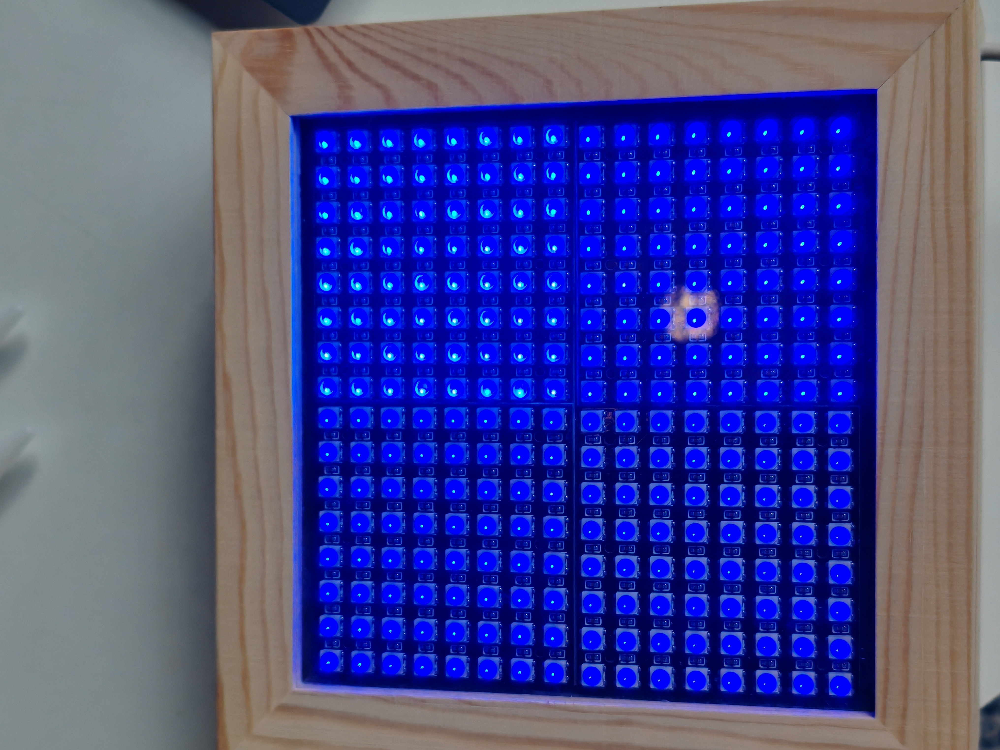
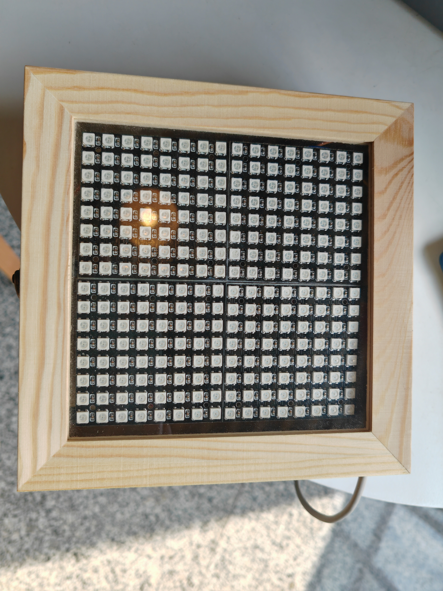
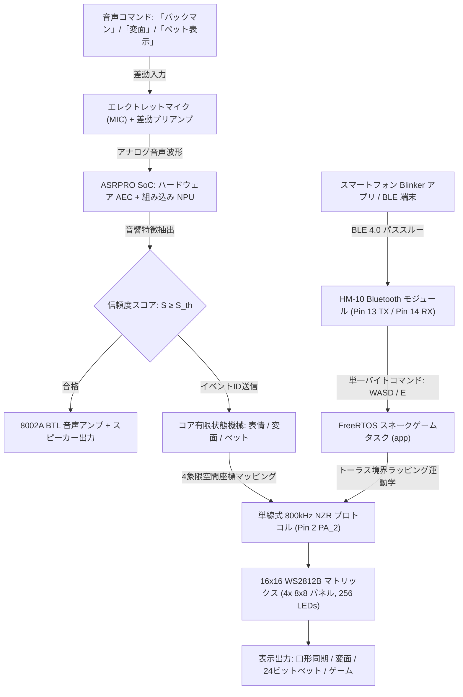
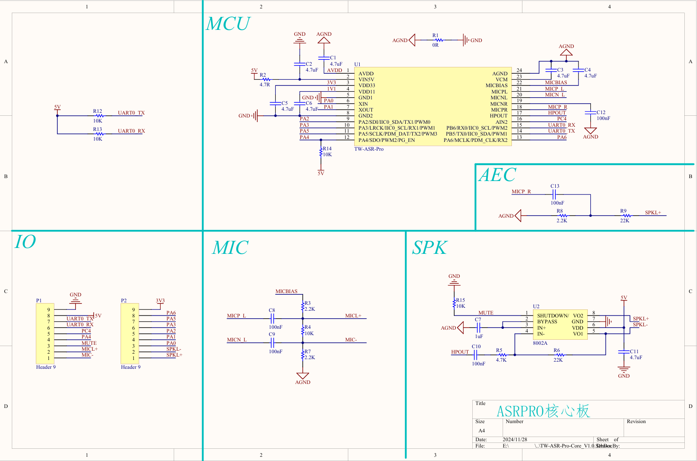
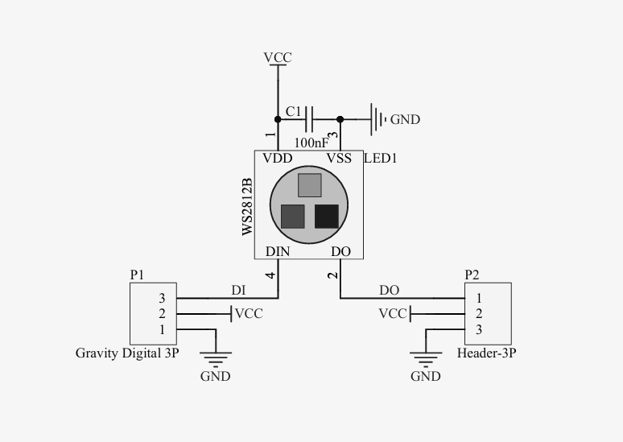
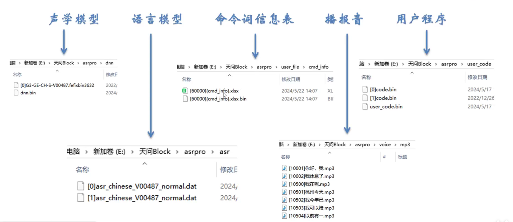
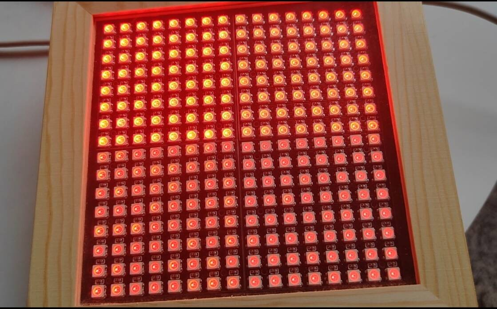

# インテリジェント完全オフライン音声対話・光音響フォトフレームシステム (基礎編)
### ASRPRO 音声認識 SoC & 16×16 WS2812B RGB マトリックス 統合組み込みフレームワーク

<div align="center">

[](LICENSE)
[](https://www.twen51.com/)
[](https://www.world-semi.com/)
[](docs/)
[](src/)
[](https://www.bilibili.com/video/BV1Y5N4zxEPX)
[-blueviolet.svg?style=flat-square)](https://www.uestc.edu.cn/)

[**中文文档**](README.md) | [**English**](README_EN.md) | [**日本語**](README_JA.md)

</div>

> 💡 **プロジェクト進化ロードマップ（光音響対話三部作）**  
> 本プロジェクトは、組み込みエッジプロトタイプからマルチモーダル身体性知能ロボットへの工学的進化を記録した「光音響インタラクティブ三部作」の**【基礎編・物理実装の礎】**です：
> - 🟢 **基礎編 (本プロジェクト)**: [Intelligent-Lighting-Control-System-Basic](https://github.com/DongFengPo1412/Intelligent-Lighting-Control-System-Basic) —— ASRPRO オンデバイス音声 SoC + 16×16 WS2812B 4象限マトリックス + HM-10 BLE 4.0。完全オフライン音響センシング、4象限空間マッピング、および物理照明統合を確立；
> - 🟡 **発展編 (中級)**: [Intelligent-Lighting-Control-System-Mid](https://github.com/DongFengPo1412/Intelligent-Lighting-Control-System-Mid) —— ESP32-S3 + ESP32-WROOM-32 非対称デュアルコア協調処理 + Jetson Nano エッジ視覚認識 + 24kHz 対数音響 FFT 音楽連動アルゴリズムへ進化；
> - 🔴 **旗艦編 (上級)**: [Intelligent-Lighting-Control-System-Pro](https://github.com/DongFengPo1412/Intelligent-Lighting-Control-System-Pro) —— 単一 ESP32-S3 ネイティブ RMT-DMA ハードウェア駆動 + オンプレミス身体性知能 LLM 推論（Qwen2.5 / MCP）+ PC 計算センター 3D 空間ハンドトラッキングおよび視線追従指向性照明へ昇華。

---

## 1. 学術的背景とプロジェクト概要

本システムは、**電子科技大学（UESTC）自動化工程学院**の学部生向け中核実践カリキュラム**「総合課程設計（基礎編）」**における優秀エンジニアリング成果として開発されました。

従来のスマート照明やヒューマン・コンピュータ・インタラクション（HCI）において、照明器具は壁面スイッチやスマートフォンの冷たいアプリ操作に依存しており、**対話次元の単調さ、情緒的フィードバックの欠落、クラウド依存、硬直的な発光パターン**という課題を抱えていました。これらを根本から解決し、超小型・完全ローカル・感情応答型のマルチモーダル光音響対話プラットフォームを実現するため、開発チームは**ASRPRO ニューラル SoC と 16×16 WS2812B フルカラーマトリックスに基づく、インテリジェント完全オフライン音声対話フォトフレームシステム**を設計・構築しました：

- **エッジ完全オフライン AI 音声エンジン**: **ASRPRO SoC**（Tianwen 51 コアアーキテクチャおよび第3世代専用ニューラル NPU コプロセッサを統合）を採用。ハードウェア音響エコーキャンセラ（AEC）と差動エレクトレットマイク回路を備え、クラウド接続を一切必要とせず、$\lt 200\text{ ms}$ の超低遅延でキーワードスポッティングおよび意図分類を実現（静音環境でのウェイクアップ率 $\ge 98\%$、ノイズ環境下で $\gt 90\%$ ）；
- **4象限ブロックカスケード高密度マトリックス**: 4枚の独立した $8 \times 8$ 剛性 PCB パネルをシームレスに結合し、**16×16 平面グリッド（合計 256 個のフルカラー RGB LED）**を構築。単線式 800kHz 高速 NZR プロトコルにより、24ビット TrueColor（1677万色）の鮮やかな描画を実現；
- **音素同期リップシンク動態エンジン**: ローカル TTS 合成音声の再生時間とマトリックス上の口形を位相ロックし、中国語音素の発音動態を忠実に再現（4フレームのウェイクアップ返答、9フレームの終了挨拶シーケンスをミリ秒単位で同期制御）；
- **デュアルトラック描画パイプライン & 24ビット フルカラーデスクトップペット**: 16ビットバイナリフォントストリーム（リフレッシュレート $\gt 100\text{ Hz}$ ）と 768 バイト RGB テンソル描画トラックを並行実装。金髪に輝く瞳を持つ 24 ビット TrueColor アニメ調ピクセルデスクトップペット（「妖精」）を極小リソースで鮮明にレンダリング；
- **FreeRTOS 駆動の組み込みスネークゲーム**: FreeRTOS のデュアルタスクスケジューリングにより、ノンブロッキング UART コマンド受信とゲーム物理演算を並行処理。トーラス（ドーナツ型）境界ラッピング、重複なしのランダムフード生成、および 3 パルスの赤色フラッシュ衝突警告を実装；
- **手作り無垢材フォトフレーム構造**: 専用の天然無垢材フレームと光学的微多孔アクリル拡散板を採用し、工業グレードの熱的安定性と洗練された室内インテリア美学を両立。

---

## 2. ハードウェア外観とシステムトポロジー

### 2.1 実機インタラクション & 無垢材フォトフレーム外観

<div align="center">

| 実機対話 & Bluetooth スネークゲーム操作 (GIF) | 16×16 無垢材フレーム & スネークゲーム点灯写真 |
| :---: | :---: |
|  |  |
| **動的実機デモ**: 無垢材フレーム内の動的点灯、4象限カラーフロー、およびスマホ操作によるリアルタイムスネークゲーム | **フレーム統合**: 4象限高精度結合された WS2812B パネルが無垢材の質感を活かして高コントラストに発光 |

| 高コントラスト感情表現（笑顔） | 4象限滑らかグラデーション虹色フロー |
| :---: | :---: |
|  |  |
| **感情表現アニメーション**: 16×16 グリッド上に紫と白の高コントラストで浮かび上がる笑顔アニメーション | **環境光フロー**: 青紫、エメラルド、アンバー、シアンが滑らかに遷移する四象限空間グラデーション |

| 24ビット TrueColor ピクセルデスクトップペット | 内部配線 & デカップリング構造 |
| :---: | :---: |
|  |  |
| **フルカラーペット描画**: 768 バイトの RGB テンソルから展開された金髪と紅い瞳を持つ高精細ピクセルアート | **実装の信頼性**: 難燃性固定、2.54mm ピンヘッダ、絶縁保護された信号・電源配線 |

</div>

* ハードウェア検証および音声対話の実機デモ全編は Bilibili にて公開されています：  
  👉 **[Bilibili で実機検証動画を視聴: インテリジェント完全オフライン音声対話フォトフレームシステム](https://www.bilibili.com/video/BV1Y5N4zxEPX)**  
  *(ASRPRO オフライン音声ウェイクアップ、16×16 RGB カラーフロー、表情リップシンクアニメーション、川劇変面、スネークゲーム実演、およびスマホ BLE 操作を完全収録)*

---

### 2.2 エンドツーエンド・システムアーキテクチャ

本システムは、音響入力、ニューラル推論、グラフィックレンダリング、ワイヤレス通信を結ぶ決定論的クローズドループを形成しています：



---

## 3. ハードウェア回路構成と電気的設計

<div align="center">

| ASRPRO コア回路図 (MCU + MIC + SPK + AEC) | WS2812B カスケード & デカップリング回路図 |
| :---: | :---: |
|  |  |
| **ASRPRO コア回路**: TW-ASR-Pro プロセッサ、AEC 適応フィードバック、差動マイクバイアス、8002A アンプ | **カスケード設計**: DIN から DOUT へのパルス整形伝送と多段コンデンサによる電源平滑化 |

</div>

### 3.1 ASRPRO 音声認識コアアーキテクチャ

- **プロセッサコア**: Tianwen 51 コアと 32 ビット専用 DSP ニューラル NPU（動作周波数 240MHz）を統合。640KB 内蔵 SRAM と高速 SPI Flash を搭載し、オフライン音響モデルと TTS PCM 波形データを保持；
- **差動エレクトレットマイク回路 (MIC)**: 超低ノイズ電源 `MICBIAS` とバランス型 DC カットコンデンサ C8, C9（0.1 μF）により、電源リップルや RF 干渉を効果的に抑制；
- **8002A 音声アンプサブシステム (SPK)**: **8002A** Class-AB オーディオパワーアンプ（SOP-8 パッケージ）を採用。BTL 構成により 5V 動作時に 3Ω 負荷へ 3W のクリーンな出力を供給（ $\text{THD} \lt 10\%$ ）；
- **ハードウェア音響エコーキャンセラ (AEC)**: アンプ出力正極 `SPKL+` から C13（100 nF）および分圧回路を介してフィードバックピン `MICP_R` へ接続。自機スピーカ出力音声をリアルタイムで適応相殺し、音声再生中の確実な「割り込み認識」を実現。

### 3.2 WS2812B 4象限マトリックスの電源完全性 (PI)

- **物理配置**: 4枚の $8 \times 8$ 独立ガラエポ基板を $2 \times 2$ 配置で結合し、$16 \times 16$ の平面マトリックスを構成；
- **カスケード配線**:
  - ASRPRO GPIO `Pin 2` (PA_2) から第0象限（左上）の `DIN` へ接続；
  - 第0象限 `DOUT` $\to$ 第1象限（右上）`DIN` $\to$ 第2象限（左下）`DIN` $\to$ 第3象限（右下）`DIN` と直列にカスケード接続（計 256 個）；
- **電流計算と電圧降下対策**:
  - 全256個の LED が最大輝度白色（`R=G=B=255`）で点灯した場合の理論ピーク電流：
    
    $$I_{\text{peak}} = 256 \times (20\text{ mA} \times 3) = 15.36\text{ A}$$
    
  - 配線抵抗による電圧降下、発熱、MCU リセットを防ぐため、ファームウェア上で最大輝度を 20% 〜 30% に制限（定常電流 $\lt 1.5\text{ A}$ ）。電源入力部には $1000\ \mu\text{F}$ 低 ESR 電解コンデンサを配置して電圧を安定化。

---

### 3.3 低消費電力 BLE 4.0 ワイヤレス通信サブシステム (HM-10)

- **モジュール選定と接続**: TI CC2541 チップセットを搭載した HM-10 BLE 4.0 モジュールを採用し、ハードウェア UART を介して ASRPRO SoC と直接接続；
- **ピンマルチプレクサ設定**: ASRPRO の `Pin 13` を `UART0_TX`（`setPinFun(13, SECOND_FUNCTION)`）、`Pin 14` を `UART0_RX`（`setPinFun(14, SECOND_FUNCTION)`）として再構成；
- **通信ボーレートと遅延特性**: ボーレート `115200 bps`（8-N-1 構成）で運用。スマートフォン側の Blinker IoT アプリケーションと連携し、遅延 $\lt 10\text{ ms}$ のリアルタイムな方向十字キーおよび制御コマンド送受信を実現。

---

## 4. 数理モデルとコアアルゴリズム

### 4.1 WS2812B 高速 NZR ナノ秒通信プロトコル

WS2812B はナノ秒精度のパルス幅変調プロトコル（ビット周期 `T_bit = 1.25 μs ± 150 ns`）を採用しています：
- **Bit 0**: High 期間 $T_{0H} = 400\text{ ns} \pm 150\text{ ns}$, Low 期間 $T_{0L} = 850\text{ ns} \pm 150\text{ ns}$；
- **Bit 1**: High 期間 $T_{1H} = 850\text{ ns} \pm 150\text{ ns}$, Low 期間 $T_{1L} = 400\text{ ns} \pm 150\text{ ns}$；
- **リセットラッチ**: Low 保持時間 $T_{\text{reset}} \gt 50\ \mu\text{s}$（ファームウェアでは $280\ \mu\text{s}$ を採用）。

各 LED は **MSB ファースト** かつ **G-R-B** バイト順の 24 ビットデータを受信します：

$$\mathbf{C} = [G_7, G_6, \dots, G_0, R_7, R_6, \dots, R_0, B_7, B_6, \dots, B_0] \in \{0, 1\}^{24}$$

$N = 256$ 個の LED を更新する合計フレーム時間 $T_{\text{frame}}$ は：

$$T_{\text{frame}} = N \times 24 \times T_{\text{bit}} + T_{\text{reset}} = 256 \times 24 \times 1.25\ \mu\text{s} + 280\ \mu\text{s} = 7.68\text{ ms} + 0.28\text{ ms} = 7.96\text{ ms}$$

これにより、理論上の最大リフレッシュレートは：

$$f_{\text{refresh, max}} = \frac{1}{T_{\text{frame}}} = \frac{1}{7.96 \times 10^{-3}\text{ s}} \approx 125.6\text{ Hz}$$

---

### 4.2 4象限ブロックカスケードマトリックス空間マッピング式

物理マトリックスは **4枚の $8 \times 8$ パネルが $2 \times 2$ 象限グリッド状に配置** されており、カスケードバスは以下の順で配線されています：
- **第0象限 (左上)**: $x \in [0, 7], y \in [0, 7]$, インデックス範囲 $[0, 63]$
- **第1象限 (右上)**: $x \in [8, 15], y \in [0, 7]$, インデックス範囲 $[64, 127]$
- **第2象限 (左下)**: $x \in [0, 7], y \in [8, 15]$, インデックス範囲 $[128, 191]$
- **第3象限 (右下)**: $x \in [8, 15], y \in [8, 15]$, インデックス範囲 $[192, 255]$

各 $8 \times 8$ パネル内は標準的な行優先走査です。したがって、直交座標 $(x, y) \in [0, 15] \times [0, 15]$ から物理シリアルインデックス $\text{Index}(x, y)$ への変換式は次のように厳密に定義されます：

$$\text{Block}(x, y) = 2 \cdot \left\lfloor \frac{y}{8} \right\rfloor + \left\lfloor \frac{x}{8} \right\rfloor \in \{0, 1, 2, 3\}$$

$$\text{Index}(x, y) = 64 \cdot \text{Block}(x, y) + 8 \cdot (y \bmod 8) + (x \bmod 8)$$

この数式は、ファームウェア `贪吃蛇.hd` 内の `getPixelIndex(x, y)` および `最终版本.hd` 内の `displaycolorfulPattern` の実装と完全に合致します。

---

### 4.3 音素同期リップシンク動態エンジン

本システムの重要な特徴は、**中国語音声合成の発音動態と LED マトリックス上の口形開口度の位相ロック同期**です。唇の形状を4つの基本形態（閉口、横開き、小開き、大開き）にモデル化し、TTS 再生時間に合わせてミリ秒単位で表示を切り替えます：

#### ウェイクアップ応答「我在」（4フレーム、合計時間：1600ms）
ウェイクワード**「吃豆人」（パックマン）**認識時にトリガーされ、音声**「我在」**に合わせて `wake_frames` を再生：

| フレーム | 音素・開口特徴 | 幾何形状 | 遅延時間 | 累積時間 |
| :---: | :---: | :---: | :---: | :---: |
| **第0フレーム** | 発声準備（無音） | 水平な閉口直線 | $100\text{ ms}$ | $0.10\text{ s}$ |
| **第1フレーム** | **「我」**（円唇後舌半狭母音 `/w/` `/o/`） | やや開いた楕円形 | $500\text{ ms}$ | $0.60\text{ s}$ |
| **第2フレーム** | **「在」**（開口二重母音 `/z/` `/ai/`） | 横に大きく開いた長方形 | $500\text{ ms}$ | $1.10\text{ s}$ |
| **第3フレーム** | 発声完了・待機状態 | 水平な閉口直線 | $500\text{ ms}$ | $1.60\text{ s}$ |

#### シャットダウン応答「好的，马上执行」（9フレーム、合計時間：3700ms）
音声コマンド**「关闭灯光」（消灯）**認識時にトリガーされ、音声**「好的，马上执行」**を再生した後に全消灯：

| フレーム | 発話漢字 | ピンイン・音素分類 | 口形カテゴリ | 遅延時間 | 状態説明 |
| :---: | :---: | :---: | :---: | :---: | :---: |
| **第0フレーム** | *(開始)* | 発声前無音区間 | 閉口 | $100\text{ ms}$ | コマンド受理 |
| **第1フレーム** | **好** | `/h/` + `/ao/`（低母音） | **大開き** | $500\text{ ms}$ | 最大口形開口 |
| **第2フレーム** | **的** | `/d/` + `/e/`（非円唇前舌半狭母音） | **横開き** | $500\text{ ms}$ | 扁平な横長開口 |
| **第3フレーム** | *(読点)* | 音節間ポーズ | **閉口** | $300\text{ ms}$ | 音節間の小休止 |
| **第4フレーム** | **马** | `/m/`（両唇鼻音） + `/a/` | **横開き** | $500\text{ ms}$ | 破裂唇開放 |
| **第5フレーム** | **上** | `/sh/` + `/ang/`（鼻母音） | **大開き** | $500\text{ ms}$ | 垂直に大きく開口 |
| **第6フレーム** | **执** | `/zh/` + `/i/`（反舌破擦音） | **小開き** | $500\text{ ms}$ | 歯を見せた小開口 |
| **第7フレーム** | **行** | `/x/` + `/ing/`（前舌鼻母音） | **横開き** | $500\text{ ms}$ | 口角を引いた開口 |
| **第8フレーム** | *(終了)* | 音声終了・消灯移行 | **全消灯** | $300\text{ ms}$ | スタンバイモードへ移行 |

---

### 4.4 デュアルトラック描画パイプライン & 24ビット フルカラーデスクトップペット

1. **16ビット バイナリフォントストリーム**: 1フレームあたりわずか 16 個の `uint16_t`（32 バイト）を消費。ビットシフト判定 `pattern[y] & (1 << (15 - x))` により $\lt 0.1\text{ ms}$ の超高速処理を実現し、表情やリップシンクを滑らかに描画；
2. **24ビット フルカラースプライトエンジン**:
   - 3組の $16 \times 16$ 2次元カラーテンソル（`red[16][16]`, `green[16][16]`, `blue[16][16]`、計 768 バイト）を展開；
   - 空間象限マッピングアルゴリズム `displaycolorfulPattern` により、**金髪のツインテール、輝くハイライト、赤い瞳、精緻な輪郭を持つアニメ調妖精ペット**を鮮やかにレンダリング。

---

### 4.5 FreeRTOS 駆動の組み込みスネークゲーム

`贪吃蛇.hd` に実装されたゲームエンジンは、FreeRTOS の協調動作により低リソース環境下で安定動作します：

- **デュアルタスク協調アーキテクチャ**:
  - タスク1 `UART_RX` (優先度 4, スタック 256): 115200bps でコマンドを受信し、**逆方向進行による即死防止ガード**を実行；
  - タスク2 `app` (優先度 4, スタック 256): $300\text{ ms}$ 周期のハートビートクロックでスネーク座標を前進；
- **トーラス（ドーナツ型）境界ラッピング運動学**:
  - $16 \times 16$ の限られた画面において、壁衝突によるゲームオーバーを防ぎ操作性を高めるため、境界ループ運動方程式を採用：
    
    $$x_0 = (x_0 + dx + 16) \bmod 16, \quad y_0 = (y_0 + dy + 16) \bmod 16$$
    
- **階層的カラーコーディング & 衝突アラート**:
  - **頭部**: 高輝度グリーン `(0, 255, 0)`；
  - **胴体**: 落ち着いたグリーン `(0, 100, 0)`；
  - **エサ**: 鮮烈なレッド `(255, 0, 0)`；
  - **自己衝突警告**: 頭部が胴体に接触すると、`flashRed()` 関数が **3 回の全画面赤色点滅パルス**（点灯300ms / 消灯300ms）を実行し、最終スコアを UART 出力。

---

### 4.6 川劇変面ステートマシン

音声コマンド**「变脸」（変面）**によってトリガー：
- 4つの古典的な表情（笑顔、ウインク、大笑い、驚き）を循環；
- 各表情を京劇・川劇の伝統的な4色（**黄金 $\to$ 朱鷺色 $\to$ 焔紅 $\to$ 深青**）へリアルタイムにカラーシフトさせながら、計3ラウンドのパフォーマンスを自動実行。

---

## 5. ファームウェアアーキテクチャと主要ソースコード解説 (Firmware Architecture)

本システムのファームウェアは、[`src/asrpro_firmware/main_asrpro_ws2812.cpp`](src/asrpro_firmware/main_asrpro_ws2812.cpp)（ネイティブ C++ 実装）および [`src/asrpro_firmware/tianwen_block_projects/最终版本.hd`](src/asrpro_firmware/tianwen_block_projects/最终版本.hd)（Tianwen Block グラフィカルプロジェクト）の両形式で完全提供されています。

### 5.1 音声認識イベントディスパッチャ (`ASR_CODE`)

ASRPRO のニューラル NPU が特定キーワード（音響スコア $S_i \ge S_{\text{threshold}}$ ）を検知すると、即座にハードウェア割り込みが発生し、対応する `snid`（Speech Neural ID）がイベントハンドラ `ASR_CODE()` に引き渡されます：

```cpp
void ASR_CODE() {
  switch (snid) {
    case 0: // ウェイクアップコール「吃豆人」（パックマン）-> リップシンク口形アニメーションを再生
      displaySpeaking1Animation();
      break;
    case 1: // コマンド「显示笑脸」（笑顔表示）-> 高コントラスト黄色スマイリーフェイス
      displayPattern(smile, 255, 255, 0);
      break;
    case 2: // コマンド「显示哭脸」（泣き顔表示）-> 4フレーム涙ポロポロアニメーション
      displaycryAnimation();
      break;
    case 3: // コマンド「变脸」（変面）-> 京劇4色循環変面パフォーマンス
      displaySmileyAnimation();
      break;
    case 4: // コマンド「显示桌宠」（デスクトップペット表示）-> 24ビット TrueColor ピクセル妖精ペット描画
      displaycolorfulPattern(red, green, blue);
      break;
    case 5: // コマンド「关闭灯光」（消灯）-> 終了リップシンクシーケンス後に全消灯
      displaySpeaking2Animation();
      ASR_WS2812_2.pixel_set_all_color(0, 0, 0);
      ASR_WS2812_2.pixel_show();
      break;
  }
}
```

---

### 5.2 24ビット TrueColor スプライト空間マッピングアルゴリズム (`displaycolorfulPattern`)

4象限にカスケード接続された 256 個の LED に対し、自然な物理デカルト座標 $(x, y) \in [1, 16] \times [1, 16]$ を 1 次元 NZR LED アドレスへリアルタイムに双射変換するアルゴリズムの C++ 完全実装です：

```cpp
void displaycolorfulPattern(const unsigned char r[16][16], 
                            const unsigned char g[16][16], 
                            const unsigned char b[16][16]) {
  ASR_WS2812_2.setBrightness(5);              // 低消費電力・アンチグレアモードに設定
  ASR_WS2812_2.pixel_set_all_color(0, 0, 0);  // フレームバッファをクリア

  // 第1象限 (左上 8x8 パネル: y: 1~8, x: 1~8)
  for (int y = 1; y <= 8; y++) {
    for (int x = 1; x <= 8; x++) {
      int index = (y - 1) * 8 + (x - 1);
      ASR_WS2812_2.pixel_set_color(index, r[y][x], g[y][x], b[y][x]);
    }
  }
  // 第2象限 (右上 8x8 パネル: y: 1~8, x: 9~16)
  for (int y = 1; y <= 8; y++) {
    for (int x = 9; x <= 16; x++) {
      int index = (y - 1) * 8 + (x - 8) + 63;
      ASR_WS2812_2.pixel_set_color(index, r[y][x], g[y][x], b[y][x]);
    }
  }
  // 第3象限 (左下 8x8 パネル: y: 9~16, x: 1~8)
  for (int y = 9; y <= 16; y++) {
    for (int x = 1; x <= 8; x++) {
      int index = (y - 9) * 8 + x + 127;
      ASR_WS2812_2.pixel_set_color(index, r[y][x], g[y][x], b[y][x]);
    }
  }
  // 第4象限 (右下 8x8 パネル: y: 9~16, x: 9~16)
  for (int y = 9; y <= 16; y++) {
    for (int x = 9; x <= 16; x++) {
      int index = (y - 9) * 8 + (x - 8) + 191;
      ASR_WS2812_2.pixel_set_color(index, r[y][x], g[y][x], b[y][x]);
    }
  }
  ASR_WS2812_2.pixel_show(); // 高速 NZR ラッチ送信
}
```

---

## 6. クロスモーダル上位機 & Blinker IoT ワイヤレス制御 (Blinker IoT & Wireless BLE)

<div align="center">

| Tianwen Block グラフィカル音声・字模設定画面 | Blinker モバイルアプリ操作ダッシュボード |
| :---: | :---: |
|  |  |
| **グラフィカル統合環境**：オフラインニューラルモデル生成、TTS 音声合成バインド、16×16 マトリックス字模設計 | **Blinker モバイルコンソール**：方向十字キー、ゲームスタートボタン、単色照明トグルパネル |

</div>

- **モバイル操作端末**: 点灯科技（Blinker）APP をカスタマイズし、BLE 4.0 経由で HM-10 モジュールと透過型 UART 接続を自動確立；
- **単一バイト ASCII プロトコル体系**:
  - `'E'`: スネークゲームの起動 / リスタート；
  - `'W'` / `'S'` / `'A'` / `'D'`: スネークの運動ベクトル制御（上 / 下 / 左 / 右）；
  - `"on"` / `"off"`: WS2812B マトリックス全体の白色点灯およびスタンバイ消灯；
- **対ノイズ性と自動再接続**: 実測 10m 以上の通信安定性を確保し、電波途絶時もアプリ側で秒単位の自動再接続をサポート。

---

## 7. リポジトリ構成と詳細ファイル一覧 (Repository Layout & Manifest)

```text
Intelligent-Lighting-Control-System-Basic/
├── docs/
│   └── images/
│       ├── demo_hardware_live_interaction.gif      # 実機インタラクション全機能実録動図 (3.5MB, 64フレーム, スネーク+光音響)
│       ├── demo_hardware_enclosure_active.jpg      # 無垢材フレーム実物点灯・インタラクション写真 (4064x3048)
│       ├── demo_led_matrix_smile_face.jpg          # 16x16 マトリックス笑顔表情・高コントラスト実写 (2448x3264)
│       ├── demo_hardware_wood_case.jpg             # 4象限レインボーグラデーション光影・木枠完成写真 (3048x4064)
│       ├── demo_pixel_desktop_pet.png              # 24ビット TrueColor デスクトップ妖精ペットピクセルアート
│       ├── demo_hardware_matrix_glow.jpg           # マトリックス発光と内部配線ディテール写真
│       ├── demo_hardware_internal_wiring.jpg       # マトリックス背面配線および絶縁保護工芸写真
│       ├── hardware_asrpro_schematic.png           # ASRPRO コアボード公式完全回路図 (MCU/MIC/SPK/AEC)
│       ├── hardware_ws2812_cascade_schematic.png   # WS2812B カスケード接続・デカップリング回路図
│       ├── hardware_asrpro_module.jpg              # ASRPRO コアボードモジュール実物写真
│       ├── software_tianwen_block_voice_config.png # Tianwen Block オフライン音声設定グラフィカル画面
│       ├── software_matrix_pattern_design.png      # 16x16 ピクセルパターン字模マトリックス設計ツール
│       └── software_bluetooth_control_app.png      # Bluetooth スマホ無線インタラクション制御画面
├── src/
│   └── asrpro_firmware/
│       ├── main_asrpro_ws2812.cpp                  # ASRPRO 完全ネイティブコアファームウェア (音声割り込み+リップシンク+TrueColorペット+変面)
│       └── tianwen_block_projects/
│           ├── 最终版本.hd                         # Tianwen Block 基礎編完全統合プロジェクト (全音素口形・ペットデータ収録)
│           ├── 贪吃蛇.hd                           # 16x16 マトリックス FreeRTOS デュアルタスク携帯型スネークゲームプロジェクト
│           ├── 蓝牙点灯.hd                         # HM-10 Bluetooth 通信制御プロジェクト
│           ├── RGB.hd                              # フルカラー色彩空間滑らかグラデーションアルゴリズム
│           ├── 功能二.hd                           # モード2機能プロジェクト
│           └── 功能三.hd                           # モード3機能プロジェクト
├── LICENSE                                         # MIT 公式オープンソースライセンス
├── README.md                                       # 中国語版技術仕様書・数式解説
├── README_EN.md                                    # 英語版包括エンジニアリング仕様書
└── README_JA.md                                    # 日本語版技術仕様書・学術ポートフォリオ
```

---

## 8. クイックスタート & ファームウェア書き込み (Quick Start Guide)

### 8.1 ハードウェア配線仕様 (Pinout Mapping)

| ASRPRO コアボード物理ピン | 接続先デバイス / モジュール | 機能・信号仕様説明 |
| :---: | :---: | :---: |
| **5V** | WS2812B マトリックス V+ / HM-10 VCC | システム主電源 DC 5V バス（ $1000\mu\text{F}$ 電解コンデンサを並列接続推奨） |
| **GND** | WS2812B マトリックス V- / HM-10 GND | システム共通グラウンドライン（共接地配線） |
| **PA_2 (Pin 2)** | WS2812B 第1象限（左上）`DIN` | 単線式 800kHz 高速 NZR デジタル制御信号線 |
| **Pin 13 (UART0_TX)** | HM-10 BLE モジュール `RXD` | 非同期シリアル送信信号線（`setPinFun(13, SECOND_FUNCTION)`） |
| **Pin 14 (UART0_RX)** | HM-10 BLE モジュール `TXD` | 非同期シリアル受信信号線（`setPinFun(14, SECOND_FUNCTION)`） |
| **SPKL+ / SPKL-** | 8Ω 2W 超小型動線スピーカー | 8002A アンプ差動 BTL 音声出力端子（内蔵 AEC サンプリング接続） |
| **MICL+ / MIC-** | エレクトレット小型コンデンサマイク | 差動アナログ音声入力端子 |

### 8.2 ツールチェーン導入 & ファームウェアビルド・書き込み

1. 公式の **Tianwen Block 2025 (TWenBlock)** 統合開発環境をインストール；
2. IDE を起動し、「プロジェクトを開く」から [`src/asrpro_firmware/tianwen_block_projects/最终版本.hd`](src/asrpro_firmware/tianwen_block_projects/最终版本.hd) をロード；
3. ASRPRO ボードを Type-C USB ケーブルで PC に接続；
4. ツールバーのターゲットデバイスとして `ASRPRO-Core` を選択し、対応する CH340 仮想シリアルポートを指定；
5. 「**モデル生成**」をクリック（キーワードや合成音声を再コンパイル）；
6. 「**2M コンパイル & ダウンロード**」をクリックして SPI Flash へファームウェアを自動書き込み。

### 8.3 対話テスト & 音声コマンド一覧

1. **システムのウェイクアップ**:
   - マイクに向かってウェイクアップワード「**吃豆人**」（パックマン）と呼びかける；
   - スピーカー応答：「*我在*」（はい、ここにいます）；
   - マトリックス上に 4 フレームの音素同期口形アニメーション（閉口 $\to$ 我 $\to$ 在 $\to$ 閉口）が滑らかに再生；
2. **感情表現 & 芸術的インタラクション**:
   - 「**显示笑脸**」（笑顔表示）: スピーカーが「*哈哈哈哈哈*」と発話、黄色スマイリーフェイスを表示；
   - 「**显示哭脸**」（泣き顔表示）: スピーカーが「*呜呜呜呜呜*」と発話、4フレームの涙アニメーションを表示；
   - 「**变脸**」（変面）: スピーカーが「*好的，请欣赏变脸表演*」と発話し、4種類の表情と4色の伝統色彩が自動循環；
   - 「**显示桌宠**」（ペット表示）: スピーカーが「*好的，小精灵来啦*」と発話し、24ビット TrueColor 妖精ペットを描画；
   - 「**关闭灯光**」（消灯）: スピーカーが「*好的，马上执行*」と発話し、9フレームの口形終了アニメーションを経て全消灯待機へ移行；
3. **Bluetooth スネークゲーム**:
   - スマホの Blinker アプリを開いてデバイスに接続；
   - `'E'` を送信してゲームを開始、`'W'`, `'S'`, `'A'`, `'D'` でスネークをリアルタイム操作。

---

## 9. 開発チーム & 謝辞 (Credits & Acknowledgments)

- **開発チーム**: 電子科技大学（UESTC）自動化工程学院 2023期 学部生中核工学実践チーム
  - 主要メンバー: **劉超然 (LIU Chaoran)** (学籍番号: 2023060904025), 張子琛 (ZHANG Zichen), 楊礼可 (YANG Like)
- **指導教員**: 電子科技大学 自動化工程学院「総合課程設計（基礎編）」教育チーム（李凱 教授、唐浩 教授）
- **オープンソース謝辞**: 基礎 SDK ライブラリを提供いただいた Tianwen 51 (TWen51) コミュニティおよび点灯科技 (Blinker) コミュニティに感謝申し上げます。

---

## 10. オープンソースライセンス (License)

本プロジェクトのソースコードおよび回路設計図面は **MIT License** のもとで公開されています。詳細は [LICENSE](LICENSE) ファイルをご参照ください。
