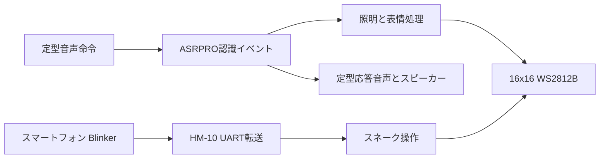

# Intelligent Lighting Control System — Basic

ASRPROのオフライン音声認識、16×16 WS2812Bマトリックス、HM-10 Bluetoothを使った光の対話試作機です。

[简体中文](README.md) · [English](README_EN.md) · **日本語**

**詳細：** [機能とソース](docs/technical-notes.ja.md#source-map) · [描画とアルゴリズム](docs/technical-notes.ja.md#graphics) · [実装範囲](docs/technical-notes.ja.md#implementation-status) · [導入と操作](docs/setup.ja.md)

電子科技大学の初級総合設計科目で開発したBasicは、共通のLED基盤で、定型音声命令、照明と表情、音楽断片に合わせたランダム照明、スマートフォン操作のスネークゲームを試作したものです。天問Blockによる設定とC/C++によるアプリケーション開発を組み合わせています。

**Basic → Mid → Pro**の第1段階として、オフライン命令、点描表示、シリアル通信の基礎を作りました。後続段階は[Mid](https://github.com/DongFengPo1412/Intelligent-Lighting-Control-System-Mid)と[Pro](https://github.com/DongFengPo1412/Intelligent-Lighting-Control-System-Pro)を参照してください。

[授業でのデモ動画](https://www.bilibili.com/video/BV1Y5N4zxEPX)。リポジトリには機能別の開発工程を保存しています。各ファイルの対応範囲とデモとの関係は[バージョンの説明](docs/technical-notes.ja.md#implementation-status)を参照してください。

## ハードウェアと操作経路

ASRPRO v2.0開発ボード、マイク、外付けスピーカーを使い、8×8 WS2812Bパネル4枚を16×16、計256灯に配置します。HM-10と主制御ボードはUARTで接続し、スマートフォンのBlinkerボタンから制御文字を送ります。

PCのUSBから給電します。購入した木製収納箱に電子回路を収め、透明な蓋の下にパネルを配置し、USBケーブル用の切欠きを加工しました。電源、信号レベル、配線は[導入ガイド](docs/setup.ja.md#hardware)を参照してください。

図は機能の入出力を示し、全保存プログラムの統合・同時実行を示すものではありません。音声機能は端末上でオフライン動作し、スマートフォン接続を必要としません。Bluetoothペアリングはスマートフォン操作の前提です。

## 機能と実装

| 機能 | 実装方法 | 根拠 |
| :--- | :--- | :--- |
| **オフライン音声** | ウェイクワード、命令、固定応答を設定し、リソース生成・ビルド・書込み後にイベントを実行。 | 各工程の語彙と`ASR_CODE`。実行時のLLM接続はありません。 |
| **音声による照明操作** | グラフィカルブロックで赤・緑・青、虹、呼吸、流れなどSDKの照明効果を割り当て。 | `功能二.hd`、`功能2.hd`。 |
| **音楽とランダム照明** | 固定音楽断片を応答音声に差し替え、棒の高さと色を乱数で生成。 | `功能三.hd`。周波数・音量・拍の解析はありません。 |
| **表情とピクセル画像** | 自作二値パターン、フレーム列、RGBデータで笑顔、泣き顔、4色表情巡回、キャラクター画像を表示。 | `最终版本.hd`。RGBキャラクターは静止画像です。 |
| **Bluetoothスネーク** | `E`で開始、`W/S/A/D`で方向操作。境界折返し、食物配置、衝突、得点を実装。 | `贪吃蛇.hd`。保存版は得点をシリアルへ出力します。 |

チームの記憶では、デモに音声でのゲーム開始とLED上の数字得点表示もありました。保存済みゲームコードでは該当経路が見つかっておらず、再現にはデモ版の補完が必要です。[機能とバージョンの対応](docs/technical-notes.ja.md#source-map)

## 主な設計

- **設定とアプリ開発の分担：** 音声リソースと標準照明効果は天問Block／SDKを使い、イベント割当て、表情ビットマップ、ゲーム、シリアル処理を作成しました。
- **小容量の描画データ：** 二値画像は16行のマスクで1枚32バイト、RGBの3面は768バイトです。分割マッピングで論理座標を4枚の8×8パネルの番号へ変換します。
- **入力と更新の分離：** スネークはUART受信とゲーム更新を別タスクとし、ループ遅延はそれぞれ2 msと300 msです。受信が毎回のゲーム更新を待たずに済む構成ですが、実測2 msの端末間遅延を意味しません。
- **状態の可視化：** 表情切替、頭・胴・食物の色分け、自身衝突後の3回赤点滅、得点で操作状態を示します。

[アルゴリズム・数式・設計上の選択](docs/technical-notes.ja.md#graphics) · [ゲームとシリアル処理](docs/technical-notes.ja.md#game)

## 実機写真と検証範囲

| 照明の実機写真 | 表情の実機写真 |
| :---: | :---: |
|  |  |

授業のデモを実施し、通常の展示では安定して操作できたとチームから報告されています。認識率、遅延、通信距離、電流、長時間運転の統制評価はなく、それらの数値性能は示しません。

Basicは定型語彙と応答、プログラム内の固定輝度、近距離Bluetooth、音声解析をしないランダム照明を用います。保存コードのビルド・添字問題と版の相違は[技術ノート](docs/technical-notes.ja.md#implementation-status)にまとめています。

## クイックスタート

1. ASRPRO対応の天問Blockと、適合するUSBシリアルドライバを用意します。
2. [機能別工程](docs/setup.ja.md#programs)を選び、灯数、ピン、語彙、シリアル設定を確認します。
3. 音声リソースを生成・準備し、実ボード向けにビルドして書き込みます。音楽デモの応答音声は別途用意します。
4. ビルド前に選択版の既知の問題を確認し、[工程別の操作](docs/setup.ja.md#operation)で試験します。

## チーム・開発・ライセンス

本ページはチームの授業成果を説明し、**刘超然 / Chaoran Liu**がリポジトリを管理します。メンバー一覧と担当範囲は確認後に補完し、現時点では各機能を個人単独の成果とは位置付けません。

今後は統合デモ版の回収、モード終了と得点表示の確認、保存コードの修正、試験記録の追加を進めます。固定命令と擬似音楽効果の制約は、後続段階の対話・音声処理開発の背景となりました。

[技術ノート](docs/technical-notes.ja.md) · [導入と操作](docs/setup.ja.md) · [Mid](https://github.com/DongFengPo1412/Intelligent-Lighting-Control-System-Mid) · [Pro](https://github.com/DongFengPo1412/Intelligent-Lighting-Control-System-Pro)

本リポジトリのアプリコードは[MITライセンス](LICENSE)です。天問Block、ASRPRO SDK、第三者のハードウェア資料、音声・画像素材はそれぞれの利用条件に従います。

## 保守と検証

2026-10版では主C++と表情 .hd のフレーム遅延を `uint16_t` にし、4枚の順序を維持してRGB添字を0始まりに修正しました。Snakeは有限の空きマス列挙を使い、満盤で終了してシリアル得点を表示し、添字256へ追記しません。UARTは開始・最新方向の要求のみを原子的に公開し、ゲームタスクが状態を専有して各ステップで直前方向への逆転を拒否します。最新値1スロットでありFIFOではありません。

実際の .hd から抽出した関数をClang/WebAssemblyで実行し、画素写像の一意性、RGB境界、空き1マス・満盤、容量までの成長、連続転向の7組を確認しました。元の遅延宣言もコンパイルしています。天問SDK全体のビルド、書込、実機再試験は未実施です。対象コンパイラにGCC/Clangの `__atomic` 組込みが必要で、SDK・スタック・スケジューリングは未検証です。
